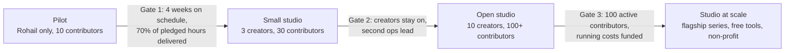

# Vision

*Last updated: 30 Sep 2026*

## In one line

We want to be Pakistan's Complexly: the non-profit studio behind many education creators, run on open, credited volunteer work, where everything educational we help make is free for everyone, forever.

> Complexly is the studio John and Hank Green built behind Crash Course, SciShow and other education channels. It gives creators a shared team and systems so they can make more, better education content. We borrow the idea, not the business model: we run on volunteers and stay non-profit.

Why we're doing this, and the facts behind it, are in [02-mission.md](02-mission.md).

## What we do

1. **Back creators.** We give education creators a free backend: planning, scripting help, fact-checking, editing, design, subtitles, analytics.
2. **Mobilise contributors.** Anyone can pledge 1 to 10 hours a week. We match those hours to real tasks for real creators and credit every contribution in public.
3. **Build free tools.** We build and share technology that makes life easier for creators, teachers and students (see [06-technology.md](06-technology.md)).
4. **Keep it all free.** Every piece of education content made with our help stays free and publicly available, always (see [03-charter.md](03-charter.md)).

## Who is involved

| Group | Who | What they get |
| --- | --- | --- |
| Creators | Education-first creators of any size, starting with Rohail Sarfraz | A team and a system, free; they stay fully independent |
| Contributors | Ideators, researchers, script reviewers, editors, designers, animators, translators, moderators, analysts | Public credit, a portfolio, skills, a community with a mission |
| Core team | The founder first, then volunteer leads per discipline | Runs the engine and protects the charter |
| Teachers and students | Everyone who watches or uses what we make | Free content, free tools, no ads from us, no paywall |

## What we will never do

- Charge creators, contributors, teachers or students for anything the studio makes.
- Put studio-made education content behind a paywall.
- Take a share of any creator's income.
- Receive or spend money without recording it in the [public ledger](08-public-ledger.md).
- Bind creators with contracts or exclusivity.
- Publish content that has not been fact-checked by a person.
- Hide a mistake. Confirmed errors are corrected in public, with a correction video and credit to whoever caught them.

## What success looks like

| Horizon | We will have |
| --- | --- |
| 3 months | 1 creator (Rohail) on a steady system, 10 active contributors, every video credited |
| 12 months | 10 creators, 100+ active contributors, a public credits board, the first free teacher tools |
| 3 years | A recognised studio with flagship series in Urdu, English and regional languages; free tools used by thousands of teachers; registered non-profit |

## How we grow

One stage at a time, each opened by a gate (details in [07-roadmap.md](07-roadmap.md)):

## Name and motto

"Open Education Studio" is a working name. The motto under consideration: **"Ilm sab ke liye"** (knowledge for everyone). Name, motto and visual identity are not yet final.
