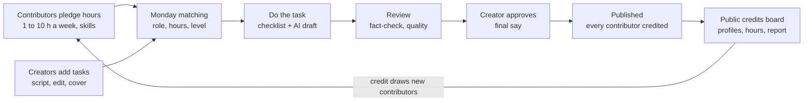

# Studio operations

*Last updated: 30 Sep 2026*

How the engine turns pledged volunteer hours into credited, published education content.

Which creators receive volunteer hours, and how many, is set by [14-creator-admissions.md](14-creator-admissions.md). This doc covers the volunteer track. Skills volunteers can't cover go to vetted, paid experts whom creators hire directly: see [09-paid-experts.md](09-paid-experts.md).

## Areas of work

Making education content well is a large operation. Each area below is a **phase of work in its own right**, with several stages inside it, and each stage will have its own steps, people and playbook. Contributors join an area and take on stages within it. How a single video moves through these areas is set out in [15-content-workflow.md](15-content-workflow.md).

| Area | What it covers | Stages inside it (examples, not exhaustive) |
| --- | --- | --- |
| **Ideation** | Deciding what to make, from a creator's overall direction down to a single video | Creator direction (what this creator stands for; which series fit them, often with the creator, their manager or an ideation group) · Series development (the series concept and its bible) · Episode ideas within a series · Approach to each topic (angle, hook, what the viewer should walk away with) |
| **Research** | Everything we need to know before writing | Fact research (claims, numbers, sources) · Approach research (how others have explained this topic, what worked, the best analogies and demos, common misconceptions viewers hold) · Audience research (what viewers ask in comments, what confuses them) |
| **Writing** | Turning research into a script in the creator's voice | Outline · Draft · Rewrites · Adapting for other languages |
| **Review and fact-checking** | Making sure it's right and it teaches | Fact-check · Subject-expert review · Script review against the series bible · Sensitive-topic review |
| **Pre-production** | Getting every batch ready to shoot | Batch planning · Shot lists and storyboards · Props and locations · Graphics prep |
| **Production** | Shoot days | Shooting · On-set backup · Upload and logging |
| **Post-production** | Turning footage into finished videos | Editing · Graphics and animation · Colour · Audio and music · Subtitles and translation · Covers · Quality check |
| **Design and brand** | The look of each creator and series | Series identities · Templates · Asset library contributions |
| **Publishing and community** | Getting it seen, and talking with viewers | Captions and scheduling · First-hour replies · Community spaces · Idea intake from comments |
| **Analysis** | Learning what works | Performance logs · Weekly notes · Monthly reviews · Learning checks |
| **Operations** | Keeping the engine running | Task matching · Onboarding · Scheduling · Volunteer care · Reporting |

A good first contribution in any area is a practice piece reviewed by that area's lead (for example, reviewing one sample script against its checklist).

## Building each system over time

We don't build all of this at once. Every area and stage moves through the same steps, at its own pace:

| Step | What it means |
| --- | --- |
| 1. **Recorded** | We write down how the work is done today, even if it's one person doing it their own way |
| 2. **Playbook** | A short written guide and checklist that a new contributor can follow |
| 3. **Templated** | Templates, examples and a place in the workflow tool |
| 4. **Tool-supported** | The platform tracks it, assigns it and generates what it can (credits, disclosures, reminders) |
| 5. **Automated where sensible** | Repetitive parts done by tools, with people making the judgement calls |

In the pilot, most areas are at step 1 or 2. That's expected: the goal right now is to **record** how each area works while we do it, so the systems can be built properly, one by one.

## Pledges

At sign-up (and any time after) a contributor sets:

- **Areas:** up to 3 areas of work.
- **Hours:** 1, 2, 5 or 10 per week.
- **Languages:** Urdu, English, Punjabi, Sindhi, Pashto, other.
- **Subjects** they know well (for fact-checkers and reviewers).
- **Creators** they would like to work with (optional).

Pledges are renewed monthly with one click. A pledge not renewed is paused automatically, so the numbers stay honest.

## Task matching

1. Creators' tasks enter one shared queue (script ready for review, footage ready for edit, cover needed).
2. Every Monday the queue is matched to contributors: right role, pledged hours left this week, right language, level high enough.
3. The contributor gets an offer on Discord and has 24 hours to accept; otherwise it goes to the next person.
4. Deadlines include a buffer: a task due in 5 days is offered at least 7 days before the creator needs it.
5. A missed task goes back to the queue. No penalty the first time; repeated misses lower the weekly offer.

Matching is run by each pod's project manager, with a studio-wide resource manager overseeing capacity across pods ([18-project-management.md](18-project-management.md)).

**Start manual, automate later:** in the pilot the PM matches by hand in ClickUp. From about 20 contributors, a bot does Monday matching (see [05-control-panel.md](05-control-panel.md)).

## Levels

Levels are earned **separately in each area of work**: someone can be a Lead in editing and a Newcomer in research. How people join, discover their strengths and are placed in creator teams is in [17-contributors-and-teams.md](17-contributors-and-teams.md).

| Level | How you get there | What you can do |
| --- | --- | --- |
| Newcomer | Accept the charter, finish a 20-minute onboarding | Practice tasks on sample scripts and footage |
| Contributor | 1 practice task approved | Real tasks; every piece reviewed before it reaches the creator |
| Trusted | 5 approved tasks, on time | Work goes straight to the creator; reviews newcomers' practice tasks |
| Lead | 20+ tasks, picked by the core team | Owns a discipline; writes its checklist; trains others |

## Quality

- Every area has a written checklist (e.g. script review: hook in the first 3 seconds, one idea per reel, every fact sourced, ending with a question or call to action).
- Every script is fact-checked by a second person before shooting.
- The creator always has the final say.
- Reported errors go to the subject-expert panel and follow the corrections policy ([charter section 4](03-charter.md#4-corrections-owning-our-mistakes)); each confirmed error also updates the relevant checklist.
- Creators rate each task 1–5 in one click; ratings feed matching and level-ups.

## Where AI helps

AI drafts and handles admin; people make the judgement calls and do the final check.

| Step | AI does | People do |
| --- | --- | --- |
| Ideas | Turns comments and trends into topic lists | Ideators pick and sharpen |
| Script | First draft in the creator's style | Reviewer and fact-checker fix and verify |
| Fact-check | Lists every claim needing a source | Fact-checker confirms with real sources |
| Edit | Auto-captions, silence cuts, rough cut | Editor shapes pacing, humour, B-roll |
| Subtitles | Draft translations | Translator corrects |
| Captions and credits | Caption, hashtags, credit block from the task board | Creator approves |
| Matching and reminders | Monday offers, deadline nudges | Ops coordinator handles exceptions |
| Reporting | Weekly numbers note, monthly public report | Analyst checks and adds insight |

Nothing AI-made is published without a named human reviewer, and every AI-assisted part is disclosed publicly ([charter section 5](03-charter.md#5-ai-transparency)).

## Keeping volunteers

Volunteer projects often lose people after the first few weeks. We plan for that:

- **Visible credit:** on the video, on a public profile, in monthly shout-outs from creators.
- **Skills and portfolio:** a short free course per role; after 10 tasks, a certificate and a reference letter.
- **Small, clear tasks:** work is broken into well-defined steps, each with a checklist.
- **Belonging:** weekly community call, a #wins channel, time with the creators.
- **Growth:** a clear path from Newcomer to Lead.
- **Easy pause:** one click, no guilt.
- **Watch the ratio:** if under 60% of pledged hours are delivered in a month, fix onboarding or task size before recruiting more.

## Weekly rhythm (core team)

Daily written updates, daily core checks, weekly planning and review, and batch meetings are set out in [18-project-management.md](18-project-management.md#meetings-and-visibility). Studio-wide, once a month:

| When | What happens |
| --- | --- |
| Last Friday of the month | Public monthly report: videos shipped, hours pledged vs delivered, top contributors, what went wrong |
