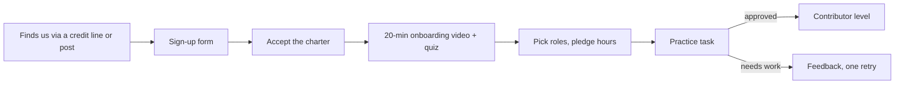
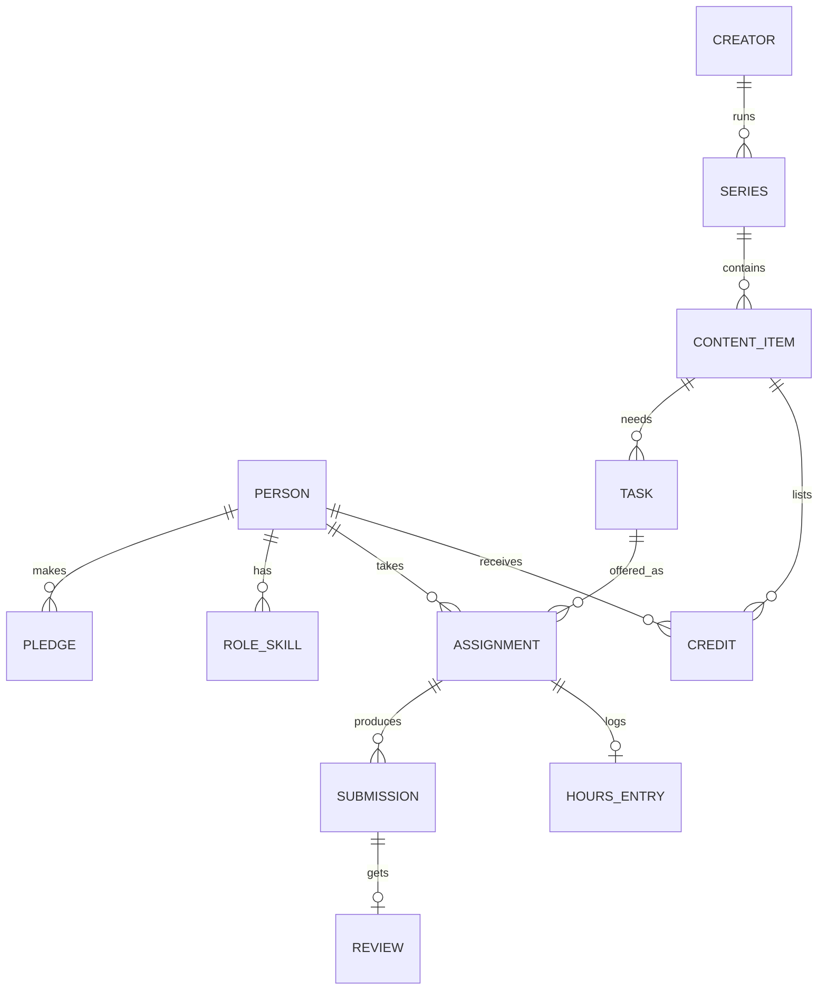

# Control panel

*Last updated: 30 Sep 2026 · Design proposal, not final*

The control panel is our internal platform: how volunteers sign up, pledge hours, get tasks, and get credited, and how the core team sees the whole engine. This doc lays out the flows, the hard problems, and a build-vs-buy path. It feeds the first real product spec.

## Principle: start with off-the-shelf tools

We don't write code until the manual process has run for at least 2 months and we know exactly what hurts.

| Stage | Contributors | Stack |
| --- | --- | --- |
| Pilot | ~10 | Google Form (sign-up + pledge) → Google Sheet (people) · ClickUp (tasks, time estimates) · Discord (offers, chat) |
| Small studio | ~30 | Same + ClickUp automations, Discord roles per level, a shared Drive per creator |
| Open studio | 100+ | Discord bot + ClickUp API for matching and reminders, public credits page |
| Scale | 300+ | Our own web app in this repo, if the tools above are holding us back |

## The four users

| User | Needs to |
| --- | --- |
| Contributor | Sign up, pledge, see offered tasks, accept, submit, see feedback, see their hours and credits |
| Creator | Add tasks, share files, review and approve, rate, copy the credit block |
| Core team / leads | See the queue, match or override, spot late tasks, level people up, run reports |
| Public | See who made what, contributor profiles, monthly numbers |

## Flow 1: sign-up and onboarding

Sign-up form fields: name or handle, city and time zone, WhatsApp or Discord handle, roles (up to 3), hours per week, languages, subjects, portfolio link (optional), age band (under-18s need a guardian's OK), charter acceptance.

## Flow 2: pledging hours

- A pledge = hours per week + roles + an availability window (e.g. weekends only).
- **Monthly renewal:** on the 1st, a one-click "still in?" message; no reply means the pledge is paused. This keeps "pledged hours" honest.
- **Temporary pause:** exams, Ramadan, travel; auto-resume date.
- **Capacity view:** the core team sees total pledged hours per role per week vs demand from creators, which tells us which roles to recruit.

## Flow 3: tasks and matching

Every task has: creator, series/episode, role, estimated hours, deadline, required level, language, brief link, files link, checklist, status.

Statuses: `Open → Offered → Accepted → In progress → Submitted → In review → Changes requested → Approved → Published → Credited`

Matching rule (v1, simple and explainable):
1. Filter: role matches, level ≥ required, language matches, hours left this week ≥ estimate.
2. Rank: preferred creator first, then the person with the fewest hours used this week (spreads work fairly), then the best rating.
3. Offer to the top person; 24 h to accept; then the next.

Leads can always override. Fairness matters more than speed: people who never get offers leave.

## Flow 4: tracking hours

This is the hardest design question. The options:

| Option | How it works | Pros | Cons |
| --- | --- | --- | --- |
| **Estimated hours (recommended)** | Each approved task credits its estimated hours | Simple, fair, no surveillance, can't be gamed | Doesn't reflect real effort |
| Self-reported | Contributor enters actual hours on submit | Captures real effort; improves future estimates | Can be inflated; needs trust |
| Timer | Start/stop timer (ClickUp or Toggl) | Most precise | Feels like surveillance; people forget to stop it |

**Recommendation:** credit **estimated** hours publicly (the "hours given" on profiles), and ask for **self-reported actual** hours privately, only to improve estimates. No timers.

## Flow 5: tracking work and quality

- Every submission is reviewed by a Trusted contributor or the creator, using the role checklist.
- The creator's 1–5 rating is attached to the task.
- Per contributor: tasks done, on-time %, average rating, hours credited, current level.
- Per creator: tasks posted, average turnaround, rejection rate (a high rate means a bad brief, not a bad contributor).

## Flow 6: credits

- When a task is marked Published, its contributor is added to the video's credit list automatically.
- The panel generates the caption credit block for the creator to paste.
- The video's public page lists contributors, roles, sources and hours.
- A contributor's public profile shows every credited video.

- The video's public page becomes the **"Meet the team"** page, with thank-you notes and, later, the "Support the team" button and contributor fund ([19-supporting-the-team.md](19-supporting-the-team.md)).

## Flow 6b: content workflow

The full idea-to-publish pipeline (phases, steps, gates, batches, change proposals, version history) is designed in [15-content-workflow.md](15-content-workflow.md). For the platform, the key decision is that **workflows are data**: each creator or series has a workflow template (phases, steps, owners, required checks), so new creators can adapt it without code. The asset library ([16-open-asset-library.md](16-open-asset-library.md)) plugs into post-production, and asset attributions flow into credits.

## Flow 6c: project management and capacity

The PM's tools are designed in [18-project-management.md](18-project-management.md): plans generated from workflow templates, a capacity board (areas × weeks, demand vs effective capacity), reliability per contributor, effort estimates learned from recorded history, staffing suggestions, cross-pod conflict alerts, and a risks and issues log.

## Flow 6d: daily updates, visibility and documents

- **Daily update bot:** asks everyone with an active task, at a fixed time in the pod's Discord channel: done, doing, blocked. Answers are attached to their tasks.
- **Check-ins and contingencies:** automatic "on track?" messages 2 days before a due date; automatic hand-over to the backup when a task passes its due date ([18-project-management.md](18-project-management.md#commitments-and-contingencies)).
- **Pod dashboard:** pipeline depth (green / yellow / red), tasks due, late and reassigned tasks, open blockers, next batch.
- **Collaborative editor:** a Google-Docs-like editor for scripts and briefs that saves every version as Markdown in Git, with who-changed-what and AI-use tracking ([15-content-workflow.md](15-content-workflow.md#documents-and-version-history)).

## Flow 7: paid experts

Separate from volunteer matching (policy: [09-paid-experts.md](09-paid-experts.md)):

- **Expert application:** role, rate within the public band, portfolio links, ID upload (private, seen by one core-team member, deleted after verification).
- **Vetting tracker:** portfolio review → skill test (with rubric score) → ID check → trial job → probation → verified.
- **Job posting:** the creator posts a brief and hours, browses verified experts (rate, rating, portfolio, availability), and hires one.
- **Job agreement:** generated from the posting and signed with one click by both sides.
- **Payment:** on approval, a ledger entry is created (studio-funded jobs) or the hire is recorded (creator-funded jobs).

Extra data: `EXPERT_PROFILE` (person, role, rate, verified date, status), `VETTING_STEP`, `JOB` (task, rate, agreed hours, total, funding source), `PAYMENT` (job, amount, ledger TX id).

## Dashboards

| Dashboard | Shows |
| --- | --- |
| Contributor home | Offers waiting, my tasks and deadlines, my hours this month, my credits, next level |
| Creator console | My pipeline by status, buffer size (ready videos), items waiting for my review |
| Ops panel | Unassigned tasks, late tasks, pledged vs delivered hours by role, people at risk of dropping out (no activity in 3 weeks) |
| Public board | Videos shipped, total hours given, top contributors this month, monthly report |
| Public ledger | Every transaction in and out, budgets with allocated / spent / remaining, receipts, CSV download (policy: [08-public-ledger.md](08-public-ledger.md)) |

## Draft data model

- **Person:** handle, contact, time zone, languages, level, status (active, paused, left).
- **Pledge:** person, hours/week, roles, window, valid from–to.
- **Task:** content item, role, estimate, deadline, required level, status.
- **Assignment:** task, person, offered/accepted/declined/expired timestamps.
- **Hours entry:** assignment, estimated hours (public), actual hours (private).
- **Credit:** content item, person, role, display name.

## Challenges to design for

| Challenge | Why it's hard | Mitigation |
| --- | --- | --- |
| Over-pledging and ghosting | Enthusiasm fades after a few weeks | Monthly renewal, small tasks, 24 h accept window, backup person per task |
| Uneven quality | Open contribution means mixed skill | Levels, practice tasks, checklists, review before delivery |
| Large video files | Slow or costly internet for many contributors | Creator uploads compressed proxies; Drive folders per item; editors work with proxies |
| Account security | Creators' accounts are valuable | Contributors never get passwords; creators post themselves |
| Minors | Students may contribute or appear on camera | Age band at sign-up, guardian consent, no personal data on public profiles for under-18s |
| Fair task distribution | The same few people get all the good tasks | Ranking by fewest hours used this week; leads audit monthly |
| Credit disputes | "I did more than it says" | Credits come from task records, not memory; appeals to a lead |
| Creator dependence | A creator relies on us, then we run short | Each creator keeps a minimum buffer; core roles have 2+ people |
| Core-team burnout | Founder is the bottleneck | Leads per discipline by Stage 2; automate reminders first |
| Privacy | We hold contacts and ratings | Minimal data, private ratings, delete on request |

## What to build first (when we build)

1. Sign-up + pledge + monthly renewal (replaces the Google Form).
2. Discord bot: Monday offers, accept/decline buttons, deadline reminders.
3. Auto credit block + public video page.
4. Contributor profile with hours and credits.
5. Ops dashboard.
