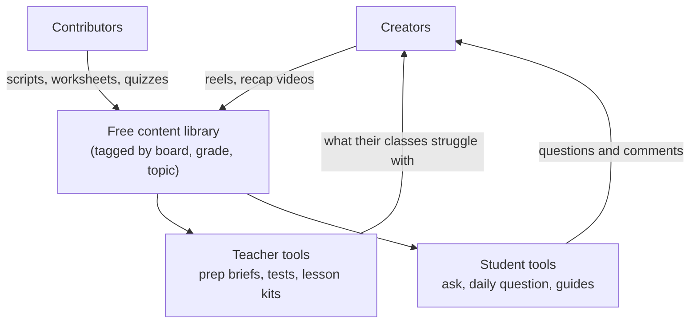

# Technology for education

*Last updated: 30 Sep 2026 · Not final*

Tools and platforms we could build to lighten the load for creators, teachers and students. All of it is free and open source (see [03-charter.md](03-charter.md)). Our own internal platform is covered separately in [05-control-panel.md](05-control-panel.md).

## Design rules for everything we build

- **Mobile first, low bandwidth.** Most users are on phones with patchy data; WhatsApp-friendly where possible.
- **Urdu first, English equal.** Roman Urdu input accepted everywhere.
- **Syllabus aware.** Map content to Pakistani boards (Federal, Punjab, Sindh, KPK, Balochistan) and O/A levels.
- **No-code first.** Prove every tool with Claude Projects, Google Forms or a WhatsApp channel before writing code.
- **A human checks it.** AI drafts are always reviewed by a teacher or fact-checker before they reach students.
- **No ads, no data selling, extra care for minors.**

## A. Tools for creators

| Tool | What it does | First version | Effort |
| --- | --- | --- | --- |
| Script assistant | Topic in, script in the creator's style out: hook, beats, punchline, props | Claude Project with the creator's best scripts | 1 day |
| Caption + credit writer | Caption, comment question, hashtags, and the credit block | Same Claude Project + task board export | 1 day |
| Comment miner | Groups a reel's comments into questions and new episode ideas | Claude + comment export | 1 day |
| Repurposer | One reel becomes a carousel, WhatsApp post, worksheet, Shorts description | Auto-captions (CapCut) + Claude | 2 days |
| Subtitle pipeline | Draft Urdu, English and regional subtitles for a human to correct | Transcription + Claude + subtitler review | 3 days |
| Weekly analytics digest | Instagram Insights numbers in, winners, losers and one recommendation out | Sheet + Claude | 1 day |

## B. Tools for teachers

| Tool | What it does | First version | Effort |
| --- | --- | --- | --- |
| Lecture prep brief | Topic + grade in, a 1-page brief out: key points, common mistakes, 3 analogies, a simple demo, 5 check questions | Claude Project with expert teachers' notes | 3 days |
| 10-minute recap videos | Teacher-facing recaps per topic ("how to teach X"), not student lessons | Made by studio creators and contributors | Ongoing |
| Test builder + class sharing | Build a test, share a link, students take it on their phones, auto-graded results | Claude to draft questions + Google Forms quiz mode | 2 days |
| Worksheet and homework generator | Board-aligned practice at 3 difficulty levels, with answer key | Claude Project + templates | 3 days |
| Analogy and demo bank | Searchable bank of the best everyday analogies and cheap demos per concept | Shared sheet, then a small site | 1 week |
| Lesson kits | Slides + worksheet + quiz + recap video per topic, free to download | Drive folder per topic | Ongoing |

## C. Tools for students

| Tool | What it does | First version | Effort |
| --- | --- | --- | --- |
| Ask a question | Students ask; an AI draft answer is checked by a volunteer teacher before it's shown; best questions become reels | Discord or WhatsApp group + Claude + teacher review | 1 week |
| Daily science question | One question a day with a short explanation and a streak (the Duolingo idea) | WhatsApp channel or Instagram Story, batch-made with Claude | 2 days |
| Tuition and exam guides | Free revision packs per board and chapter: summaries, past-paper patterns, common mistakes | PDF packs from contributors, fact-checked | Ongoing |
| Explain it 3 ways | Pick a concept, get it explained for a child, a matric student and a university student | Claude Project, later a web page | 3 days |

## D. How the pieces connect

The long-term platform is a **free, tagged content library** that creator videos, teacher tools and student tools all draw from and feed back into.

## Priorities

| Priority | Build | Why first |
| --- | --- | --- |
| Now (pilot) | Script assistant, caption + credit writer, analytics digest | Saves our pilot creator time from week 1 |
| Next | Test builder (Forms), lecture prep brief, daily science question | No-code tests of the teacher and student ideas |
| Later | Ask a question, content library, worksheet generator | Needs contributors and content volume first |
| Much later | Our own teacher platform app | Only if the no-code versions show real, repeat use |

**Validation rule:** a tool graduates from no-code to real code only when at least 100 teachers or students use it for a month.

**Starting point:** teacher tools begin with physics for grades 9–10 (most of the pilot creator's content is physics), tested with a few partner schools.
