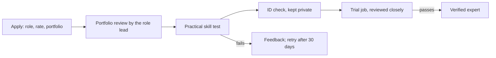

# Paid experts

*Last updated: 30 Sep 2026 · Not final*

Volunteers carry most of the work, but some skills (skilled editing, animation, subject-expert fact-checking) are hard to find for free. For those, the studio adds a second track: **vetted experts who are paid for their time**. The studio still makes no money from this; it only passes money through, in public.

## Two tracks, one community

| | Volunteer | Paid expert |
| --- | --- | --- |
| Who | Anyone who accepts the charter | People who pass the skill vetting for a role |
| How work arrives | Monday task offers based on pledged hours | Creators choose and hire them for a job |
| Pay | None | Their hourly rate, set within the studio's public rate band |
| Vetting | Practice task, then levels | Portfolio, skill test, trial job, ID check |
| Credit | Named on every piece | Named on every piece, same format |
| Agreement | The charter only | The charter + a one-page job agreement per hire |

- **One person can be both.** Someone can volunteer as a script reviewer and be a paid expert editor. They just can't be paid and credited as a volunteer for the same task.
- **Volunteers can move up.** Any volunteer can apply for expert vetting in their role, and Trusted volunteers skip the portfolio step.
- **Paid work is still free content.** Everything made with a paid expert follows the free-forever rule ([03-charter.md](03-charter.md)).

## Vetting

Experts have to be good at the job, so every paid role has the same five steps:

| Step | What happens |
| --- | --- |
| Portfolio review | The role lead checks 3 real samples of past work |
| Skill test | A standard test per role, scored against a written rubric. Examples: edit a set of raw clips into a 45-second reel in 48 hours; fact-check a script with 10 planted errors; design a series cover from a brief. Tests longer than 1 hour are paid at the base rate |
| ID check | National ID or passport verified by a core-team member, never published |
| Trial job | A real, small, paid job with extra review |
| Probation | The first 3 jobs are rated by the creator and the role lead |

**Staying verified:** an average creator rating of at least 4 out of 5 and no missed deadlines without notice. Experts who slip go back to probation. Experts are re-checked once a year.

## Rates

- Each paid role has a **public rate band** (minimum and maximum PKR per hour), set by the core team and reviewed every 6 months.
- Experts set their own hourly rate within the band and show it on their profile.
- Jobs are quoted up front in hours, as a fixed total, before work starts. Extra hours need the payer's approval first.

The first rate bands will be set from local freelance rates and published before the first paid job.

## Hiring flow

1. The creator posts a job: role, brief, deadline, estimated hours.
2. The creator sees verified experts for that role, with rates, ratings, portfolios and availability, and picks one. Creators have full control over who they hire.
3. The expert accepts; a one-page job agreement is generated (scope, hours, total, deadline, usage rights, credit line).
4. Work is delivered and reviewed; the creator approves or asks for up to 2 rounds of changes.
5. Payment is released on approval, and the expert is credited on the video.

## Who pays

| Funding | How it works | In the public ledger? |
| --- | --- | --- |
| **Studio budget** | Donations fund a budget per creator or project (e.g. "Rohail: editing, Q1 2027"). The creator chooses the expert; the studio pays | Yes, every payment, with the expert's name, role, hours and amount |
| **Creator's own money** | A creator hires an expert through the studio and pays them directly | No (it's not studio money), but the hire and the credit are recorded |

The studio **never takes a fee or a commission** on either.

## Rules

- **Paid experts are never members of the studio's legal entity.** A Section 42 company may not pay its members or their close relatives ([20-legal-and-payments.md](20-legal-and-payments.md)).
- Tax is withheld on payments where the law requires it.
- Payment goes out within 7 days of approval.
- Disputes go to the role lead, then the core team; the aim is a fair outcome within 14 days.
- Experts keep the right to show their work in their portfolio.
- Paid experts follow every charter rule volunteers follow (privacy, sourcing, conduct).
- Studio budget is used for experts only where volunteers can't cover the need. The monthly report shows how much was paid vs volunteered, per role.

## Risks

| Risk | Mitigation |
| --- | --- |
| Volunteers feel it's unfair that others are paid | Open rate bands and ledger; paid work only for skills volunteers can't cover; a clear path for volunteers to become experts |
| Weak experts slip through | Standard tests, a trial job, probation, yearly re-checks |
| Budget runs out mid-project | Jobs are only posted against budget already in the ledger |
| Studio becomes a freelance marketplace | Only education creators, only charter-bound content, no commission |

## When

Not in the pilot. Paid experts start in the **Open studio** stage, only once there is donated budget in the public ledger ([07-roadmap.md](07-roadmap.md)). Creators paying experts with their own money can start earlier, from the **Small studio** stage, once vetting is in place.
