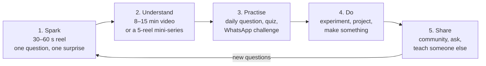

# Learning in the AI era

*Last updated: 30 Sep 2026 · Position paper, not final*

When any fact is one question away from an AI, "why should I learn this?" is a fair question. Our answer shapes everything the studio makes.

## Our answer in one line

**AI can give answers; people still need to understand, judge, and make.** So we teach curiosity, understanding, judgement and making, on top of the basics everyone needs.

## What stops being enough

- **Memorising facts.** Recall still helps, but it is no longer a job skill on its own.
- **Following a fixed procedure.** Anything that is a recipe (a standard calculation, boilerplate code, a template letter) is increasingly done by machines.
- **Exam-only learning.** Rote learning for board exams leaves students with marks but not understanding, and AI makes that gap more visible.

## What matters more, not less

| Layer | What it means | Why it matters with AI | Example content |
| --- | --- | --- | --- |
| 1. Foundations | Reading, writing, arithmetic, in the learner's own language | You can't question, check or direct AI without them. Millions of Pakistani children don't have them yet | Urdu reading stories, everyday maths, no-text-needed video for beginners |
| 2. Understanding | Mental models of how the world works: why, not just what | You can only tell when an AI answer is wrong if you understand the idea | Everyday science, how things work, "explain it 3 ways" |
| 3. Judgement | Reasoning, evidence, probability, spotting misinformation, AI literacy | AI can be confidently wrong; deepfakes and rumours spread on WhatsApp | "Humans logic lagao", Myth or Science, how to check a claim, how AI works and fails |
| 4. Making | Building, experimenting, creating, solving real problems | Agency: using tools, including AI, to make something of your own | Kitchen Lab, craft and art shows, science fair projects, coding to build |
| 5. Character | Ethics, empathy, civic sense, collaboration, communication | The questions machines can't answer for us: what is right, what do we want | Stories of scientists and ordinary heroes, civic sense, teamwork challenges |
| 6. Learning to learn | Curiosity, asking good questions, persistence, using AI as a tutor not a crutch | Skills keep changing; the ability to learn new ones stays | How to study, how to ask AI good questions, how to check its answers |

## Answering "why learn to code (or anything) if it can be automated?"

We say this directly in our content:

- **You learn it to understand it, not to compete with a machine at it.** Learning to code is learning how systems think, so you can direct them, check them and fix them.
- **Tools make experts stronger first.** People who understand a field get the most out of AI in it.
- **Understanding is freedom.** Someone who understands money, health, science and media can't be easily fooled, by people or by machines.

## Rules for our own content

1. **Start from a question, not a fact.** Every piece opens with something the viewer wonders about.
2. **Explain the why.** A fact without the reason behind it doesn't count as teaching.
3. **Show how we know.** Wherever possible, show the evidence or the experiment, not just the conclusion.
4. **Give the viewer something to do.** A question to answer, an experiment to try, a claim to check.
5. **Teach AI as a tool.** Show AI being used well (a tutor, a sparring partner) and badly (copying, believing without checking).

## The short-form problem, and our answer: the curiosity ladder

Short videos spark interest but rarely build deep understanding, and many people only watch short videos. We don't fight that; we build a ladder where every step is useful on its own and leads to the next.

- **Every reel teaches one complete idea**, so even a viewer who never climbs higher learns something true.
- **Every reel ends with an open question** and points to the next step (the long video, the mini-series, the daily question).
- **Mini-series give depth in short form:** 5 connected reels on one topic, numbered, each building on the last.
- **Practice is where learning sticks:** short quizzes and daily questions bring back ideas days later (spaced, active recall).
- **Doing makes it yours:** cheap home experiments and projects, shared back to the community.
- **We measure climbing, not just views:** how many viewers move from a reel to the long video, the quiz, or a project.