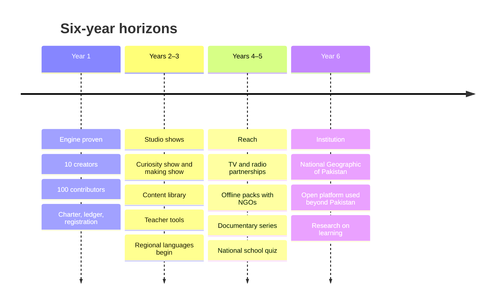
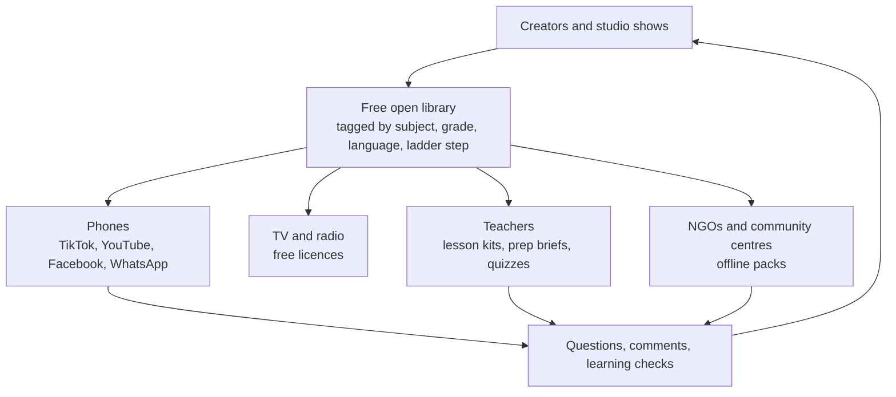

# Long-term plan (6 years)

*Last updated: 30 Sep 2026 · Not final*

## Where we're going

By 2032, the studio should be **Pakistan's home for curiosity**: the National Geographic and Complexly of Pakistan, run openly and for free. That means flagship Urdu shows on screens and phones, hundreds of creators and contributors behind them, free tools in teachers' hands, and content that reaches children who never go to school.

This plan is the path to the 10-year goals in [02-mission.md](02-mission.md), which also sets out the facts behind it.

## What we focus on first

We earn the right to do the big things by doing a few small things very well.

1. **The engine** (creators + volunteers + charter + ledger) proven with one creator, then ten.
2. **One flagship format** that proves the curiosity ladder works (spark → understand → practise → do).
3. **Trust:** accuracy, credits, transparency, from day one.
4. **Everything open and tagged**, so that later partners (schools, NGOs, TV) can use it for free.

What we deliberately **don't** do in the first two years: our own apps, TV channels, schools, or out-of-school programmes of our own. We prepare for them by making open content, and partner when the time comes.

## The plan by horizon

### Year 1 (to Sep 2027): prove the engine

| Area | Goal |
| --- | --- |
| Creators | Rohail as pilot, then 10 creators across science, maths, tech, life skills |
| Contributors | 100 active contributors, pledged vs delivered hours ≥ 70% |
| Content | Rohail's series running; first 5-reel mini-series; first ladder experiments |
| Platforms | Every creator posting on TikTok, YouTube (Shorts + long) and Facebook, not only Instagram |
| Tools | Script assistant, caption/credit writer, analytics digest (no code) |
| Organisation | Charter and ledger live; legal entity registered; 3–5 trustees |
| Measure | Ladder conversion: share of reel viewers who reach the long video or quiz |

### Years 2–3 (to Sep 2029): the studio's own shows

| Area | Goal |
| --- | --- |
| Flagship shows | **"Kyun?"** (animated Urdu curiosity show) and **"Bana Ke Dekho"** (making and art show for children), 1 episode a week each |
| Creators | 30–50 creators, including a creator incubator with priority for women and teachers outside the big cities |
| Library | Every video tagged by subject, grade, board, language and ladder step; free, searchable, downloadable |
| Teachers | Lecture prep briefs, test builder, lesson kits for the core science topics of grades 6–10 |
| Students | Daily question with streaks; "Ask a question" with teacher-checked answers |
| Languages | Subtitles/dubs in Punjabi, Pashto, Sindhi, Saraiki for flagship content |
| Paid experts | Vetted experts funded through the public ledger |
| Measure | Learning checks with 20 partner schools |

### Years 4–5 (to Sep 2031): reach beyond the phone

| Area | Goal |
| --- | --- |
| TV and radio | Flagship shows licensed free to PTV, private channels and FM radio (they carry the licence; we stay content-only) |
| Out-of-school children | Offline packs (SD cards, TV-ready episodes, audio lessons) given free to NGOs and community learning centres (e.g. TCF, AIOU-linked programmes); foundational reading and maths content in regional languages |
| Documentary | **"Hamara Pakistan"** series: rivers, mountains, deserts, wildlife, engineering, heritage; with universities and conservation groups |
| Events | Annual national school science quiz and a making/science fair |
| Platform | Our own open-source platform (library, teacher tools, contributor panel), if the no-code stack has hit its limits |
| Measure | Independent evaluation of learning outcomes in partner communities |

### Year 6 (to Sep 2032): an institution

| Area | Goal |
| --- | --- |
| Brand | The National Geographic of Pakistan: documentary, children's and curiosity programming people know by name |
| Openness | Our platform and content used by creators and NGOs in other countries |
| Research | A small research unit on how people learn in the AI era, publishing openly |
| Sustainability | Diversified funding (many small donors, grants, partnerships), never more than 30% from one source |

## How we reach children who never go to school

We can't reach them through Instagram. We reach them through the adults and channels already around them.

| Channel | How | Our role |
| --- | --- | --- |
| TV | Free licence of flagship shows to PTV and private channels | Make broadcast-ready episodes |
| Radio | Audio versions of stories and daily questions for FM | Make audio-first versions |
| Community centres and NGO schools | Offline packs: video on SD cards and USBs, printable worksheets | Make and share; partners distribute |
| Shared family phones | Short, low-data, voice-first videos on WhatsApp and Facebook | Make low-data versions |
| Mothers and older siblings | Content that helps a parent teach a child at home | Parent guides with each episode |

Our part is to make the best free content possible, in the right formats and languages, and to hand it to people who already reach these children.

## How content for everyone connects

## What would make us change course

- **Ladder conversion stays near zero after Year 1** → rethink formats before scaling creators.
- **Pledged-hour delivery stays under 60%** → fix the volunteer model before adding creators.
- **A partner or funder seeks editorial control** → walk away, even if it costs reach.
- **Learning checks show no gain** → change content design before growing reach.
