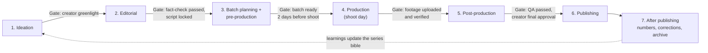
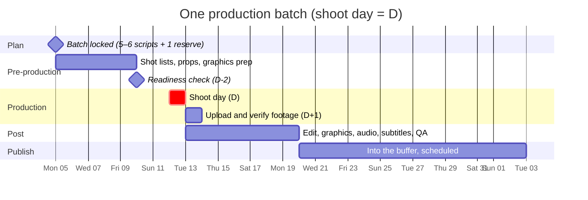

# Content workflow

*Last updated: 30 Sep 2026 · Not final*

How one video moves from "I want to make a video on gravity" to published, reviewed, credited, and archived. It borrows the best ideas from how software is reviewed on GitHub, without asking creators or volunteers to learn Git.

## The model in one picture



- Every **phase** has a **phase lead** (like a code owner) and several **steps** inside it.
- Every step has an **assignee**, a **checklist**, and sometimes a **reviewer**.
- A content item can only pass a **gate** when all its **required checks** are green, just as a pull request can't be merged until its checks pass and reviewers approve.
- Everything that happens is recorded: who did what, which version, which comments, and **whether AI was used, with which tool**. **Credits and the AI disclosure are generated from this record**, not typed from memory ([charter section 5](03-charter.md#5-ai-transparency)).

## What we borrow from GitHub

| GitHub | Our version | Why it helps |
| --- | --- | --- |
| Repository | **Creator space**: all of a creator's series, items, assets and rules | One home per creator |
| README / CONTRIBUTING | **Creator playbook** and **series bibles** (below) | Everyone knows the creator's style before touching their work |
| Issue | **Idea card** | Anyone can propose; creator triages |
| Pull request | **Change proposal**: a suggested edit to a script, cut or cover, discussed and approved before it's accepted | Nothing changes without review; every change is traceable |
| Code owners | **Phase leads and series owners**, auto-assigned as reviewers | The right person always reviews |
| Required checks (CI) | **Gate checklists**: fact-check passed, copyright clear, Urdu version, credits present | Quality doesn't depend on memory |
| Branch protection | **Gates** between phases | No skipping fact-check to hit a deadline |
| Commits and history | **Version history** of scripts (v1, v2…) and cuts (cut 1, cut 2…) | Roll back, compare, credit accurately |
| Line comments | **Comments on a script line** or **at a video timestamp** | Precise, actionable feedback |
| Releases | **Published video** with its credits, sources and version | A public record of what went out |
| Workflow files (Actions) | **Workflow templates** per creator or series | Each creator can have their own steps while sharing a default |

**Why not use GitHub itself?** Git is great for text but poor for video, and most editors, designers and teachers won't want to learn it. We copy the ideas; the pilot runs on ClickUp, Google Docs (suggestion mode is our "pull request" for scripts) and a timestamped video review tool. Later, our own platform does it natively ([05-control-panel.md](05-control-panel.md)).

## Before anything: creator playbook and series bibles

Every creator has a **playbook**, and every series has a **bible**. They are the "rules of the repo" that every reviewer checks against.

**Creator playbook** (one page): who the creator is, their core principles, voice and tone, audience, language rules, things they never do, how they like feedback.

**Series bible** (one page per series). Example for Rohail's teacher-POV series:

| Field | Example |
| --- | --- |
| Series | Nazar-e-Subject |
| Promise to the viewer | Everyday life seen through one teacher's subject; you'll laugh, then learn one real concept |
| Core principles | Science is the punchline; every term shown on screen is used correctly; one concept explained properly by the end |
| Structure | Hook (0–3 s) → 4–6 everyday moments with subject terms → the one concept explained (10 s) → question to viewers |
| Length | 30–45 s |
| Tone | Warm, playful, never mocking students |
| Visual identity | Cover template, fonts, colours, on-screen text style (from the [asset library](16-open-asset-library.md)) |
| Required checks | Every term used correctly; the concept line fact-checked; Urdu audio |
| Owner | Rohail (series owner) |

A new episode on gravity inherits all of this. Reviewers check the script against the bible, not their personal taste.

## Phase by phase

The steps listed under each phase are the main ones. Each step is itself a small process that will get its own playbook, checklist and templates over time ([04-studio-operations.md](04-studio-operations.md#building-each-system-over-time)); in the pilot, we record how each one is actually done.

### 0. Creator and series development (runs alongside, not per video)

Before individual videos, there is a longer-running track that shapes what a creator makes at all.

| Stage | Who | Output |
| --- | --- | --- |
| 0.1 Creator direction | Creator, with their manager or an ideation group | What the creator stands for; audiences; the creator playbook |
| 0.2 Series ideas | Ideation group | Candidate series that fit the creator, based on what already works and what's missing |
| 0.3 Series development | Ideation lead + creator | The chosen series' concept, format, and series bible |
| 0.4 Series review | Creator + analyst | Periodic check: keep, change, or retire a series |

### 1. Ideation (per video) · lead: ideation lead

| Step | Who | Output |
| --- | --- | --- |
| 1.1 Idea submitted | Anyone (creator, volunteer, viewer comment) | Idea card: topic, series, hook, why now |
| 1.2 Triage | Ideation lead | Duplicate? In scope? Fits a series? Tagged and prioritised |
| 1.3 Approach research | Researcher | How others have explained this topic and what worked; the best analogies and demos; the misconceptions viewers hold; what our audience has asked about it |
| 1.4 Fact research | Researcher | Key facts, numbers and sources the video will rest on |
| 1.5 Angle and approach | Ideation lead + creator | How this video will tackle the topic: the angle, the hook options, the one thing the viewer should take away |
| 1.6 Greenlight | Creator | Yes / not now / no |

**Gate:** creator greenlight.

### 2. Editorial · lead: editorial lead

**Who writes the script?** Each creator chooses one mode in their playbook:
- **Creator writes**, contributors review.
- **Writer drafts**, the creator rewrites in their own voice (AI-assisted drafts allowed).
- **Creator talks, writer shapes**: the creator records a voice note on the idea; a writer turns it into a script.

| Step | Who | Output |
| --- | --- | --- |
| 2.1 Outline | Writer or creator | Beats following the series structure |
| 2.2 Script draft | Writer or creator | Script v1 in the series template |
| 2.3 Fact-check | Fact-checker | Claims table: every claim, verdict, source |
| 2.4 Expert review | Subject expert (required for health, safety or sensitive topics; optional otherwise) | Approved / changes requested |
| 2.5 Script review | Script reviewer | Checked against the series bible: hook, clarity, one idea, language |
| 2.6 Script lock | Creator | Final version locked; changes after this need a change proposal |

**Gate:** fact-check passed + (expert approved, if required) + creator locked the script.

### 3. Batch planning and pre-production · lead: production lead

Production runs in **weekly batches of 5–6 videos**, shot in one day. Every batch is fixed **one week before** its shoot day, so pre-production has a full week.



| Step | When | Who | Output |
| --- | --- | --- | --- |
| 3.1 Batch locked | D−7 | Production lead + creator | 5–6 locked scripts + 1 reserve |
| 3.2 Shot list and storyboard | D−7 to D−3 | Director / pre-production volunteer | Shots per video, angles, on-screen text |
| 3.3 Props, location, wardrobe | D−7 to D−3 | Production assistant | Checklist per video |
| 3.4 Graphics and B-roll prep | D−7 to D−2 | Designer / animator | Graphics list; assets pulled from the library |
| 3.5 Teleprompter / cue cards | D−3 | Writer | Final lines in reading format |
| 3.6 Readiness check | D−2 | Production lead | Every video ready, or swapped for the reserve |

**Gate:** readiness check passed at D−2.

### 4. Production (shoot day) · lead: production lead

| Step | Who | Output |
| --- | --- | --- |
| 4.1 Shoot | Creator + crew | All takes, with a slate (item ID) at the start of each |
| 4.2 Backup on set | Crew | Two copies before leaving the location |
| 4.3 Upload | Crew | Footage in the creator's storage, named by convention (below), within 24 hours |
| 4.4 Verify and log | Assistant editor | Files open, nothing missing; best takes marked |

**Gate:** footage uploaded and verified.

### 5. Post-production · lead: post-production lead

| Step | Who | Output |
| --- | --- | --- |
| 5.1 Rough cut | Editor | Cut 1 |
| 5.2 Creator review | Creator | Timestamped comments |
| 5.3 Fine cut | Editor | Cut 2 (and more, versioned) |
| 5.4 Graphics and animation | Designer / animator | On-screen text, diagrams |
| 5.5 Colour | Editor or colourist | Colour pass (a preset from the library for most reels) |
| 5.6 Audio | Audio editor | Clean voice, licensed music from the library, loudness levelled |
| 5.7 Subtitles | Subtitler | Urdu and English subtitles |
| 5.8 Other language versions (optional) | Translator / dubber | English or regional-language versions; Urdu version always present |
| 5.9 Cover | Designer | Cover from the series template |
| 5.10 QA | QA reviewer | Final checklist (below) |
| 5.11 Final approval | Creator | Approved for publishing |

**QA checklist (the "required checks")**
- [ ] Every fact on screen matches the fact-checked script
- [ ] Urdu audio version exists
- [ ] Subtitles present and synced
- [ ] All music, footage, fonts and images are from the library or licensed; licences recorded
- [ ] Credit block generated, including the "AI use" line (or "none")
- [ ] On-screen "AI" label wherever an AI voice, realistic AI image or AI video appears
- [ ] Text inside safe zones for every platform
- [ ] No faces of minors without recorded consent
- [ ] Matches the series bible (length, structure, cover)

**Gate:** QA passed + creator final approval.

### 6. Publishing · lead: publishing lead

| Step | Who | Output |
| --- | --- | --- |
| 6.1 Caption, hashtags, credit block | Publishing volunteer | Caption per platform |
| 6.2 Schedule | Publishing lead | Slot per platform (TikTok, YouTube, Facebook, Instagram) |
| 6.3 Publish | Creator (creators post themselves, or through a scheduling tool they control) | Live links recorded on the item |
| 6.4 First hour | Community volunteer | Pinned comment, replies to questions |

### 7. After publishing · lead: analyst

| Step | When | Output |
| --- | --- | --- |
| 7.1 Numbers | 24 h and 7 days | Performance log updated |
| 7.2 Retro note | 7 days | One line: what worked, what didn't; updates the series bible if needed |
| 7.3 Corrections watch | Ongoing | Error reports go to the [corrections policy](03-charter.md#4-corrections-owning-our-mistakes) |
| 7.4 Archive | 30 days | Project files and raw footage moved to archive storage; credits and sources published on the video's public page |

## Roles across the workflow

| Phase | Lead (owner) | Does the work | Approves |
| --- | --- | --- | --- |
| Ideation | Ideation lead | Anyone, researchers | Creator |
| Editorial | Editorial lead | Writers, fact-checkers, experts | Fact-checker, expert, creator |
| Pre-production | Production lead | Pre-production volunteers, designers | Production lead |
| Production | Production lead | Creator, crew | Production lead |
| Post-production | Post-production lead | Editors, designers, audio, subtitlers | QA reviewer, creator |
| Publishing | Publishing lead | Publishing and community volunteers | Creator |
| After publishing | Analyst | Analyst, corrections panel | Core team |

## Footage storage and naming

- **One storage space per creator**, one folder per content item: `CREATOR/SERIES/ITEM-ID_short-title/` with `01_script`, `02_raw`, `03_project`, `04_exports`, `05_cover`, `06_subtitles`.
- **File names:** `ITEM-ID_scene_take` (e.g. `RS-0142_s03_t2.mp4`).
- **Proxies:** low-resolution copies for editors with slow internet; the final render uses the originals.
- **Backups:** 3 copies, 2 kinds of storage, 1 off-site. Raw footage kept 12 months after publishing, then only selects and final exports.

## Workflow templates (how the platform will model this)

Each creator or series has a workflow template: the default template with changes. This is the heart of the future platform: phases, steps, owners and required checks are **data**, not code, so a new creator can adjust them without a developer.

```yaml
# workflow: default-reel (a series can extend it)
phases:
  - id: ideation
    lead: role:ideation-lead
    steps: [submit, triage, research-brief, greenlight]
    gate: { approvals: [creator] }
  - id: editorial
    lead: role:editorial-lead
    steps: [outline, script-draft, fact-check, expert-review?, script-review, script-lock]
    gate:
      checks: [fact-check-passed]
      approvals: [creator]
      require_expert_if_tags: [health, safety, sensitive]
  - id: preproduction
    lead: role:production-lead
    batch: { size: 5-6, lock_before_shoot_days: 7, readiness_check_days: 2, reserves: 1 }
    steps: [shot-list, props, graphics-prep, cue-cards, readiness-check]
  - id: production
    steps: [shoot, backup, upload, verify]
    gate: { checks: [footage-verified] }
  - id: postproduction
    lead: role:post-lead
    steps: [rough-cut, creator-review, fine-cut, graphics, colour, audio, subtitles, versions?, cover, qa, final-approval]
    gate:
      checks: [facts-match-script, urdu-audio, subtitles, licences-recorded, credits-generated, safe-zones, minor-consent]
      approvals: [creator]
  - id: publishing
    steps: [caption, schedule, publish, first-hour]
  - id: after
    steps: [numbers-24h, numbers-7d, retro, archive]
```

## Documents and version history

**Ground rule: every document has a full history.** For any script, brief, bible or checklist, we can always see who changed what, when, and why, and go back to any earlier version.

### Three ways to do it

| Option | Good | Weak |
| --- | --- | --- |
| **Google Docs** | Everyone already knows it; real-time editing; suggestion mode and comments; version history | History is hard to compare line by line; lives outside our repo; locked to one company |
| **Markdown files in Git (GitHub)** | Exact line-by-line history; pull-request reviews; lives in our own repo; open and portable | Hard for non-technical writers and reviewers; no real-time co-editing |
| **Our own editor in the platform** | A Google-Docs-like editor that saves every version as Markdown in Git: easy to use, with full history, credits and AI-use tracking built in | Has to be built |

### What we use, by kind of document

| Kind of document | Pilot | Later |
| --- | --- | --- |
| **Studio documents** (charter, playbooks, checklists, templates, these docs) | Markdown in this Git repo, changed by pull request | Same |
| **Series bibles and creator playbooks** | Markdown in Git, changed by pull request (they're the "rules of the repo") | Same, editable through the platform editor |
| **Scripts, research briefs, fact-check tables** | Google Docs in suggestion mode, with named versions (v1, v2); at **script lock**, a snapshot is exported to Markdown and committed to Git | Written in the platform editor; every save is a version in Git |
| **Video files, designs** | Shared drive, versioned by file name (cut 1, cut 2) | Storage linked to each content item; versions recorded in the platform |

### How content is laid out in Git

```
content/
  rohail-sarfraz/
    series/
      nazar-e-subject/
        bible.md                  # the series bible
        RS-0142_gravity/
          brief.md                # idea card and approach research
          claims.md               # fact-check table: claim, verdict, source
          script.md               # the locked script
          credits.yml             # who did what, and AI use (generates the credit block)
```

This gives every video a permanent record: what was researched, what was claimed and checked, what was said, and who did it. That record feeds credits, the AI disclosure, and corrections.

## Running it in the pilot (no code)

| Concept | Pilot tool |
| --- | --- |
| Items, phases, steps, gates | ClickUp: one list per creator; statuses = phases; checklists = steps and required checks; custom fields = batch, series, lead |
| Scripts and change proposals | Google Docs in suggestion mode; version names v1, v2; "locked" = view-only, with a Markdown snapshot committed to Git |
| Timestamped video review | A video review tool that supports timestamped comments (or YouTube unlisted + comments with timestamps) |
| Footage storage | A shared drive per creator, with the naming convention |
| Batches | A ClickUp view grouped by batch date |
| Credits | Assignees on each step → a credit block written from the card |