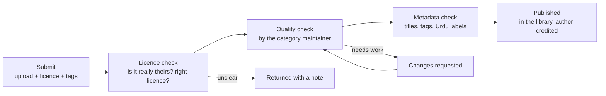

# Open asset library

*Last updated: 30 Sep 2026 · Not final*

A free, open, community-built library of everything a Pakistani education creator needs to make a video: fonts, music, sound effects, footage, templates, diagrams, characters, research packs. Anyone can use it; anyone can contribute to it.

## Why it matters

- **It saves every creator time and money:** no hunting for music or diagrams, no paying for templates.
- **It protects creators from copyright strikes:** every asset has a clear licence.
- **It fills gaps nobody else fills:** Urdu-labelled science diagrams, Pakistani B-roll, Urdu fonts and subtitle styles, a glossary of Urdu scientific terms.
- **It's how many people contribute:** a musician, a photographer or an illustrator can help education without joining a production.

## What goes in it

| Category | Examples | Priority |
| --- | --- | --- |
| **Urdu science diagrams** | Labelled diagrams (the eye, the water cycle, circuits, forces), editable | High, unique to us |
| **Urdu scientific glossary** | English term, Urdu term, simple Urdu explanation, pronunciation; e.g. velocity → raftaar (with direction) | High, keeps language consistent across creators |
| **Series and brand templates** | Cover templates, lower thirds, subtitle styles, end cards with credit blocks, intro/outro stings | High |
| **Music and sound effects** | Background tracks and stings, including by Pakistani musicians; sound effects for skits | High |
| **Pakistani B-roll and photos** | Cities, villages, rivers, mountains, markets, traffic, classrooms, kitchens, weather | High |
| **Fonts** | Urdu Nastaliq and Naskh fonts for on-screen text and covers, plus Latin fonts; only fonts with open licences | Medium |
| **Icons and illustrations** | Science icons, Pakistani everyday objects (rickshaw, chai cup, UPS, charpai) | Medium |
| **Animation kits** | Studio characters and rigs, animated diagram kits, transitions | Medium |
| **Editing presets** | Colour presets, caption styles, project templates for common free editing apps | Medium |
| **Research packs** | One-page fact sheets per topic, with sources and common misconceptions | Medium, feeds the editorial phase |
| **Data and maps** | Pakistan maps (provinces, rivers, climate), open data sets with sources | Medium |
| **Script and workflow templates** | Series bible template, script templates, fact-check claims table, QA checklist | High, from [15-content-workflow.md](15-content-workflow.md) |
| **3D models** | Molecules, planets, simple machines | Later |

## Licences

Every asset has exactly one licence, recorded with it. We only accept:

| Licence | Used for |
| --- | --- |
| **CC0** (public domain) | Anything the author gives away completely |
| **CC BY 4.0** | **Default for everything the studio makes**: anyone can use it, including creators who earn ad revenue, as long as they credit the author |
| **CC BY-SA 4.0** | When the author wants adaptations to stay open |
| **SIL Open Font License** | Fonts |

We **don't** accept "free to download" assets with unclear licences, assets under non-commercial licences (they would block creators who earn ad revenue), or anything the contributor doesn't own.

**Note on the charter:** written learning materials (worksheets, quizzes, guides) stay under CC BY-NC-SA, so nobody can sell them. **Production assets** in this library use CC BY, so every creator can use them freely in videos, including monetised ones.

## Every asset records

| Field | Example |
| --- | --- |
| ID | AST-0217 |
| Title (Urdu and English) | Water cycle diagram / Aabi chakkar |
| Type | Diagram |
| Licence | CC BY 4.0 |
| Author | Name or handle, profile link |
| Source | Original work / adapted from (link) |
| Tags | water, rain, grade 6, geography |
| Language | Urdu labels |
| Formats | SVG, PNG, editable Canva/Figma link |
| Attribution line | "Diagram: Sana M., Open Education Studio, CC BY 4.0" (auto-generated) |
| Used in | Videos that used it (for credits and impact) |

When a creator uses an asset, its attribution line is added to the video's credit block automatically. Our "credit everyone" tenet includes the people behind the assets.

## Contributing an asset (a pull-request-style review)

- **Two ways to submit:** a simple upload form for everyone, or a pull request on the repo for people who use GitHub.
- **Maintainers per category** (music, footage, diagrams, fonts, templates), exactly like open-source project maintainers. They review, merge and keep quality high.
- **Accuracy review for diagrams and research packs:** a subject expert signs off before publishing, like any studio content.
- **Takedown process:** anyone can report an asset (wrong licence, error, harmful); it's hidden within 48 hours while reviewed.
- **Wanted list:** a public list of assets creators need but the library lacks, so contributors know what to make.

## How it's hosted

| Stage | Setup |
| --- | --- |
| Pilot | A shared Drive folder by category + a sheet as the index (ID, licence, author, tags, link) |
| Small studio | A public GitHub repository for the index, small assets, templates and the glossary (so the community can contribute by pull request); large files (footage, music) on a shared drive |
| Open studio | A simple website: search, preview, download, attribution line copy button; large files on low-cost object storage |
| Later | Built into our platform: assets can be picked from inside the workflow, and usage is tracked automatically |

## Getting it started

1. **Seed it from the pilot:** every template, cover, diagram and preset made for Rohail goes into the library under CC BY from day one.
2. **Commission a starter music pack** from volunteer Pakistani musicians (10 tracks, 20 stings).
3. **Run a B-roll drive:** volunteers across the provinces film 10 short clips each of their city or village.
4. **Start the Urdu glossary** with the 200 most common school-science terms.