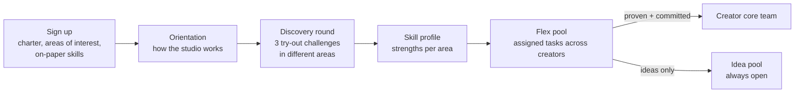
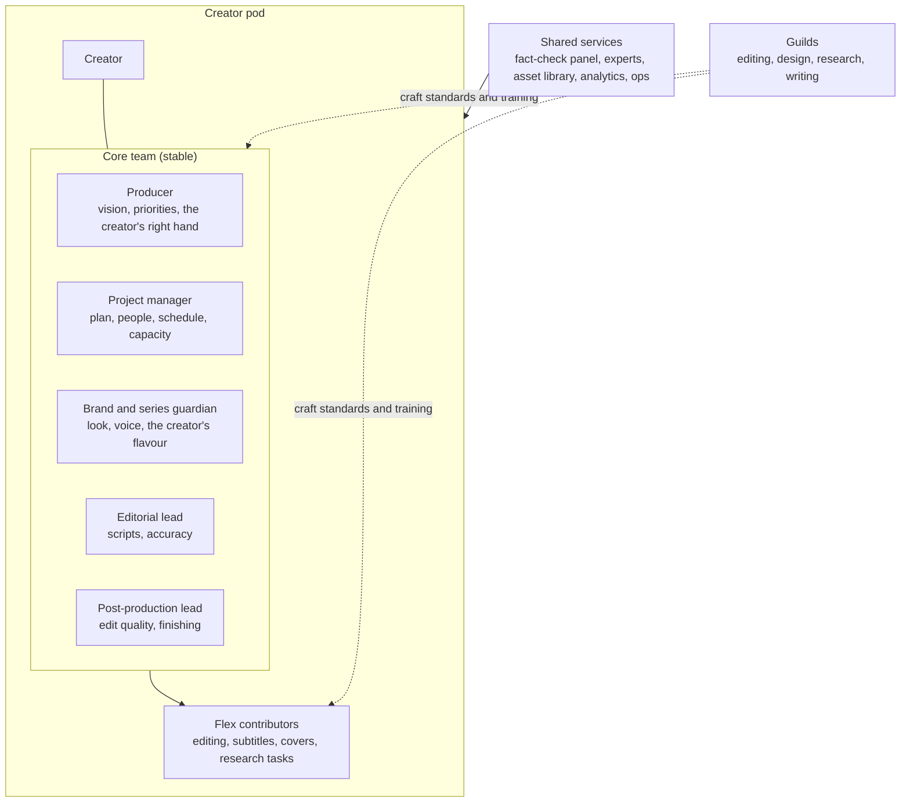

# Contributors and teams

*Last updated: 30 Sep 2026 · Not final*

How new people join, how we find out what they're good at (including skills they don't know they have), how we keep the door open without drowning reviewers, and how people are organised around each creator.

## Three principles

1. **Open door, narrow funnel.** Anyone can contribute ideas from day one; only assigned work reaches reviewers. Openness never turns into a review queue nobody can clear.
2. **Show, don't tell.** Skills are discovered by trying small real challenges, not by reading CVs.
3. **Stable core, flexible edges.** Each creator has a dedicated core team that owns their vision; a wider pool helps with the hands-on work.

## Three kinds of skill

| Kind | Examples | How we find it |
| --- | --- | --- |
| **On paper** | Physics teacher, programmer, doctor, translator | Declared at sign-up; checked for expert roles |
| **Craft** | Editing, design, animation, writing, audio | Try-out challenges and portfolio |
| **Instinct** | A feel for ideas, hooks, what a channel needs, what social media rewards, what a viewer will find confusing | Idea challenges, prediction games, idea-pool track record |

Instinct is the kind most often missed, and it matters most in ideation and creator direction. Many people have it without knowing it.

## Joining: from sign-up to placement

### The discovery round

Every newcomer picks **three short try-out challenges**, at least one outside their comfort zone. Each is scored by a Trusted member of that area against a written rubric.

| Area | Try-out challenge |
| --- | --- |
| Ideation | Pitch 5 video ideas for a given series, each with a hook |
| Instinct | Watch 6 past reels and predict which 2 did best, with reasons (actual results are revealed afterwards) |
| Research | Find how 3 other creators explained a topic; say what worked and what didn't |
| Fact-checking | Find the planted errors in a sample script |
| Writing | Rewrite a weak hook and a confusing paragraph |
| Editing | Cut provided raw clips into a short reel |
| Design | Make a cover from a brief and a template |
| Audience | Read 50 real comments and list the 5 questions viewers most want answered |

The result is a **skill profile**: a strength score per area, visible to the person and to leads. People are often surprised; someone who signed up as an editor may turn out to have the best instinct for hooks.

### Levels are per area, not per person

A person can be a Lead in editing and a Newcomer in research. Levels (Newcomer → Contributor → Trusted → Lead, see [04-studio-operations.md](04-studio-operations.md)) are earned separately in each area, through approved work in that area.

## Keeping the door open without flooding reviewers

Open-source projects are struggling with floods of low-effort, often AI-generated, contributions that nobody has time to review. We design against that from the start.

**The key rule: no unsolicited work.** Nobody submits a script, an edit or a design that wasn't assigned. Expensive-to-review work only exists when someone asked for it. The only thing anyone can submit unasked is an **idea**, and ideas are cheap to sort.

| Input | Who can submit | How it's filtered before a person reviews it |
| --- | --- | --- |
| **Ideas** | Anyone, any level | Required idea-card format (incomplete cards are returned automatically); duplicates merged; community up-votes; the ideation lead reviews only the weekly shortlist |
| **Practice work** | Newcomers | One practice task at a time; a capped practice queue per area; reviewed by Trusted members, not leads |
| **Assigned tasks** | Contributors and above | Only exists because a creator or lead requested it; reviewed by the creator's core team |
| **Proposals to change a playbook or checklist** | Trusted and above | Reviewed monthly by the area lead |

**More safeguards**
- **Review budgets:** each reviewer sets how many reviews they can do a week. When the queue is full, new practice work waits; it doesn't pile up.
- **Earned capacity:** newcomers can submit a few ideas a week; people whose ideas get picked earn more slots.
- **Peer review first:** Trusted members review newcomers; leads only see escalations and shortlists.
- **AI disclosed and checked:** AI-assisted submissions must say so (as in [charter section 5](03-charter.md#5-ai-transparency)). Repeated low-effort AI submissions lose submission slots.
- **AI helps triage, people decide:** tools can check format, merge duplicates and summarise, but a person makes every accept or reject call.

## Always-open channels for newcomers

So that nobody with good ideas is shut out while they build a track record:

- **The idea pool:** open to everyone, all the time; top ideas each week go to creators, credited to whoever suggested them.
- **Monthly idea jam:** an open call where anyone can pitch to a creator's core team.
- **Monthly challenges:** "best hook for this topic", "best cover for this series"; winners are credited and noticed.
- **Critique threads:** after a video is published, a thread for "what would you have done differently?" Good critics get invited into try-outs for ideation and direction.
- **Shadowing:** watch a core team's weekly meeting to learn how decisions are made.

## Teams: a pod for each creator

Each creator gets a **pod**: a small, dedicated core team plus a flexible pool around it.

### Core team (stable)

- **Producer:** the creator's manager in the studio. Owns the vision with the creator and the pod's priorities. The person the creator speaks to first.
- **Project manager:** turns priorities into a staffed plan: divides the work, checks capacity, allocates people, keeps batches on schedule ([18-project-management.md](18-project-management.md)). One PM can serve two or three small pods.
- **Brand and series guardian:** makes sure everything looks and sounds like this creator. Owns the series bibles and templates.
- **Editorial lead:** owns script quality and accuracy for this creator.
- **Post-production lead:** owns the finish: editing standards, QA.

In the pilot, one or two people can hold several of these roles. Core team members **commit for at least 3 months** with a steady weekly pledge, because quality comes from knowing the creator.

### Flex contributors (rotating)

Hands-on tasks (a cut, subtitles, a cover, a research brief) go to the flex pool through normal task matching. Flex contributors can work for several creators; they follow the pod's playbook and series bible, and their work is reviewed by the pod's core team. **Flex people can change without losing quality, because the vision sits with the core team and in the written bible.**

### Guilds (across all pods)

Everyone also belongs to the **guild** for their craft (editing, design, research, writing). Guilds set craft standards, run training, share techniques and review checklists. The pod keeps each creator's flavour; the guild keeps the craft consistent across creators.

### Shared services

Some things are shared by every pod: the subject-expert and fact-check panel, the asset library, analytics, and operations.

### Senior people across pods

From about 5 pods, a **creator success lead** looks after 3–5 pods: supports producers, spots problems early, and moves learning between pods.

## Moving between tiers

| Move | How |
| --- | --- |
| Newcomer → flex pool | Discovery round done; one practice task approved in an area |
| Flex → core team | Invited by the producer after consistent work for that creator; agrees to the 3-month commitment |
| Core → another creator | Planned, not ad hoc: with a handover to a successor and an updated bible |
| Anyone → pause | One click; core members give notice so the producer can arrange cover |

## Assigning people to creators

- **Preferences first:** contributors list creators they'd like to work with.
- **Fit second:** skill profile and language match the pod's needs.
- **Start broad, then settle:** new people do flex work across 2–3 creators first, then choose (and are chosen by) a pod.
- **Every pod keeps a bench:** at least one backup for each core role, so one person leaving never stops a creator.

## What the platform needs for this

These feed the control panel ([05-control-panel.md](05-control-panel.md)): skill profiles with per-area levels; try-out challenges and rubric scoring; the idea pool with voting and duplicate merging; submission slots and review budgets; pods, core roles, flex assignments and guild membership.
