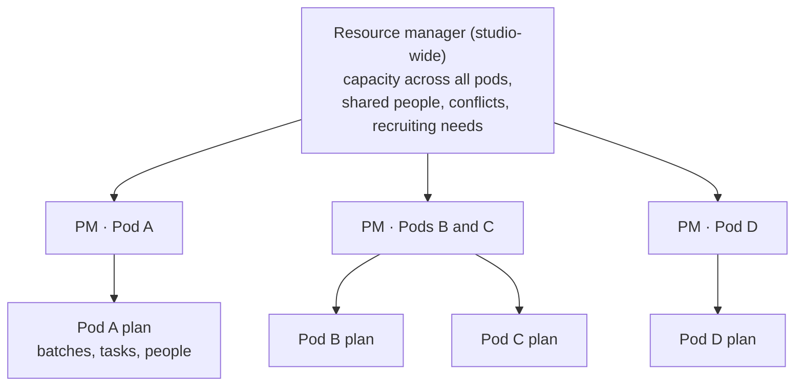
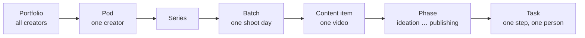
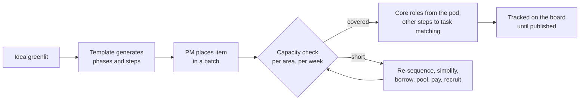

# Project management

*Last updated: 30 Sep 2026 · Not final*

How we turn greenlit ideas into staffed, scheduled work: who plans it, how we know whether we have the people, and what happens when we don't. With volunteers whose time is uncertain, this is one of the hardest jobs in the studio, and it needs its own role and its own system.

## Producer and project manager: two different jobs

| | Producer | Project manager (PM) |
| --- | --- | --- |
| Owns | **What** we make and **why**: the creator's vision, series, priorities | **How** and **when** it gets made: the plan, the people, the schedule |
| Asks | "Is this the right video for this creator?" | "Do we have the people to make it by batch day?" |
| Works with | The creator, the brand guardian, the editorial lead | Area leads, contributors, other PMs, the resource manager |
| Measured by | Quality and growth of the creator's channel | Work delivered on time, capacity used well, people not overloaded |

In a small pod one person can do both, but the two jobs are always named separately so neither is forgotten.

## The PM structure

- **Pod PM:** plans and runs delivery for one pod, or two to three small pods.
- **Resource manager:** sees capacity across the whole studio; settles conflicts when two pods need the same people; tells recruiting which skills we're short of; approves borrowing people between pods.
- **Project management office (later):** once there are several PMs, the resource manager and lead PMs own the shared methods, templates and training described here.

## Who manages each creator's team

Three models are possible. The studio uses one of them per stage, not a mix in the same pod.

| Model | How it works | Good | Risk |
| --- | --- | --- | --- |
| **A. Creator self-manages** | The creator runs their own team and schedule, using studio tools | Simple; the creator is fully in control | Creators' time goes to management instead of creating; quality depends on each creator's organising skill |
| **B. One PM for several creators** | A PM runs delivery for 2–3 pods; each pod's producer owns the vision | Efficient; the PM learns across pods and spots shared problems | The PM becomes a bottleneck if pods grow |
| **C. One PM per creator** | Every pod has its own PM | Close attention to each creator | Needs many PMs; hard to staff with volunteers |

**Working model:** creators create, they don't manage. In the pilot, the founder is Rohail's producer and PM. From the second creator, **model B**: one PM for up to three small pods, moving to model C for a pod once it's large enough to need a full-time PM.

## How work is broken down

When an idea is greenlit, the PM doesn't invent the tasks by hand. The pod's **workflow template** ([15-content-workflow.md](15-content-workflow.md)) generates every phase and step for that item; the PM then schedules and staffs them.

## Capacity: do we have the people?

### Supply: who is available

For each area of work (research, writing, editing, design…) and each week:

- **Pledged capacity:** what contributors have pledged in that area.
- **Reliability:** each person's record of delivering what they pledged. A new person starts with a cautious assumption until they have a track record.
- **Effective capacity** = pledged capacity adjusted for reliability, minus known absences (exams, Ramadan, travel).

### Demand: what the work needs

- Each step in the workflow has an **effort estimate**. Estimates come from **recorded history**: as work is done, the system learns how much each kind of step usually takes for each kind of video. Until there is history, the PM estimates with the person doing the work.
- Demand for a week = the effort of every step scheduled in that week, per area.

### The capacity board

The PM's main screen: areas down the side, weeks across the top, each cell showing demand against effective capacity.

| Area | This week | Next week | In 2 weeks | In 3 weeks |
| --- | --- | --- | --- | --- |
| Research | 🟢 | 🟢 | 🟡 | 🟢 |
| Writing | 🟡 | 🟢 | 🟢 | 🟢 |
| Editing | 🔴 | 🟡 | 🟢 | 🟢 |
| Design | 🟢 | 🟢 | 🔴 | 🟢 |
| Subtitles | 🟢 | 🟢 | 🟢 | 🟢 |

🟢 comfortably covered · 🟡 tight · 🔴 short

### Planning rules

- **Plan to about 70% of effective capacity.** Volunteers get sick, have exams, drop out. The unplanned 30% is the safety margin.
- **Critical steps get a backup person:** script lock, footage upload, final approval.
- **Limit work in progress:** a person holds only a few open tasks at a time, so work finishes instead of piling up half-done.
- **The pipeline is the real shock absorber.** Work runs weeks ahead of publishing, so that a missed commitment never means a missed post (see "Pipeline depth" below).

## Pipeline depth: the green zone

Because our contributors are volunteers, everything must happen well in advance. Every pod keeps a deep pipeline, measured in videos at each stage.

| Stage of the pipeline | Target for a pod posting 4 videos a week | Why |
| --- | --- | --- |
| **Ready to publish** (finished, approved, scheduled) | **12+** (3 weeks of posting) | A whole production batch can fail and nothing is missed |
| **In post-production** | 6 (one batch) | Editing always has work queued |
| **Scripts locked, waiting for a shoot** | 12 (two batches) | Two shoot days are always ready |
| **Greenlit ideas with approach research** | 30+ | Writers never wait for ideas |
| **Total in the pipeline** | **60+ videos** | About 15 weeks of content somewhere in the system |

The pilot starts smaller (8 ready to publish, per [Rohail's plan](creators/rohail-sarfraz/growth-plan.md)) and grows toward these targets.

| Status of "Ready to publish" | Meaning | PM action |
| --- | --- | --- |
| 🟢 **Green:** 12 or more | Healthy | Room to try new formats and series |
| 🟡 **Yellow:** 6–11 | Thinning | No new experiments; add an extra batch; fill core roles' backups |
| 🔴 **Red:** under 6 | At risk | Use evergreen reserve videos; post less often for a while rather than lower quality; escalate to the resource manager |

Each pod also keeps **2–3 evergreen videos** that can be published any time, held back for emergencies.

## When there isn't enough capacity

The PM works down this list, in order:

1. **Re-sequence:** move the item to a later batch; pull a reserve item forward.
2. **Simplify:** a simpler format for this item (fewer graphics, a preset instead of custom colour).
3. **Borrow:** ask the resource manager for a person from another pod with spare capacity.
4. **Ask the pool:** post the task to the wider flex pool with a clear deadline.
5. **Pay:** hire a vetted paid expert, if budget exists ([09-paid-experts.md](09-paid-experts.md)).
6. **Recruit:** flag the shortage to the resource manager so recruiting targets that skill.

What the PM never does: push volunteers past their pledge, or skip a quality gate to hit a date.

## Commitments and contingencies

Every commitment is a task with **one owner and one due date**. Nothing is "agreed in a meeting" without becoming a task.

| When | What happens |
| --- | --- |
| **Due date minus 2 days** | Automatic check-in to the owner: "On track, at risk, or need help?" |
| **"At risk" or no reply within a day** | The PM contacts the owner and alerts the task's backup person |
| **Due date passes with no submission** | The task moves to the backup person (or back to the queue); the owner is thanked and released, no blame |
| **Second missed task in a month** | The PM talks to the contributor about a smaller pledge or a pause |
| **Critical path at risk** (script lock, shoot, final approval) | Escalate to the producer the same day; swap in a reserve item |

- **Every critical task has a named backup** before it starts.
- **Work is saved as it goes** (drafts attached to the task), so a backup can pick up where the owner stopped.
- **Late work is never hidden:** late and reassigned tasks show on the board and in the weekly review, so we fix causes (unclear briefs, oversized tasks) rather than blame people.

## From greenlit idea to staffed plan

## Meetings and visibility

**Principle: the work is visible without the meeting.** Every task, update, draft and review lives in the task tool, so anyone who misses a meeting can open the board and see exactly what was done, by whom, and what's late. Meetings are for decisions and unblocking, not for finding out status.

### Ground rules

1. **If it isn't on the board, it isn't happening.** Every piece of work is a task with an owner and a date.
2. **Work is attached, not described.** Submissions (drafts, cuts, designs) are attached to the task; "done" means the work is there to see.
3. **Updates are written.** A short written update beats a spoken one: it stays on the record.
4. **Every document has a history.** Who changed what, and when, is always recoverable (see [documents and version history](15-content-workflow.md#documents-and-version-history)).
5. **The PM owns the rhythm.** The PM makes sure every meeting below happens, has notes, and turns decisions into tasks.

### The meeting rhythm

| Meeting | When | Who | Format | Output |
| --- | --- | --- | --- | --- |
| **Daily update** | Every working day | Everyone with an active task | **Written, in the pod's Discord channel** (a bot asks at a fixed time): done yesterday, doing today, blocked by | The PM reads all updates and acts on blockers the same day |
| **Daily core check** | Every working day, 15 min | Pod core team (producer, PM, leads) | Short voice call, or written on busy days | Blockers resolved; decisions recorded as tasks |
| **Weekly planning** | Monday | PM + core team | Call | This week's tasks confirmed, offers sent, next batch's capacity checked |
| **Weekly review** | End of week | Creator + core team | Call | Drafts and cuts reviewed; feedback given; approvals made |
| **Batch lock** | Shoot day minus 7 | Producer + PM + creator | Call | Batch items and reserve fixed |
| **Readiness check** | Shoot day minus 2 | PM + production lead | Call or written | Every item ready, or swapped |
| **Batch retro** | After each batch | Whole pod | Written, 3 questions | What worked, what didn't, what we change |
| **Monthly capacity review** | Monthly | PMs + resource manager | Call | Supply vs demand for the next 4–8 weeks; recruiting needs |
| **Quarterly planning** | Quarterly | Producers + PMs + creators | Call | Series plans and the capacity they need |

Volunteers are never required to attend calls; the written daily update is enough. Calls are recorded as short written notes, posted where everyone can read them.

### The visibility dashboard

The PM keeps one page per pod that anyone in the pod can open:

- Pipeline depth by stage, with green / yellow / red status.
- Tasks due this week, by owner, with status.
- Late and reassigned tasks.
- Today's written updates and open blockers.
- Next batch: items, readiness, reserves.

## The PM's rhythm

| When | What the PM does |
| --- | --- |
| **Daily** | Read the written updates; resolve or escalate blockers; run the daily core check |
| **Monday** | Weekly planning: confirm this week's tasks, send offers, check next batch's capacity |
| **Wednesday** | Mid-week check: anything at risk for the batch? |
| **D−7** | Batch lock with the producer: which items, which reserve |
| **D−2** | Readiness check: every item ready, or swapped |
| **After each batch** | Short retro: what slowed us down, what to fix in the template or estimates |
| **Monthly** | Capacity review with the resource manager: supply vs demand per area for the next 4–8 weeks; recruiting needs |
| **Quarterly** | With producers: series plans for the quarter and the capacity they'll need |

## Risks and issues log

Each pod PM keeps one simple log, reviewed weekly:

| Type | Example | Owner | Action |
| --- | --- | --- | --- |
| Risk | Only one editor has capacity in exam season | PM | Line up a backup editor from another pod |
| Issue | Footage from batch 12 missing a scene | Production lead | Reshoot at the next batch |
| Dependency | Diagram pack from the asset library needed for 3 items | Design guild | Due before D−3 |
| Decision | Drop animation from item 142 to hit the batch | Producer + PM | Recorded |

## Measures of good project management

| Measure | What it tells us |
| --- | --- |
| On-time rate per phase | Where work gets stuck |
| Time from greenlight to published | How fast the pipeline flows |
| Buffer size (finished videos waiting) | How safe the posting schedule is |
| Pledged vs delivered capacity | How realistic our planning is |
| Load per person | Whether anyone is overloaded, or unused |
| Rework rate | Whether quality problems are costing time |
| Contributor satisfaction | Whether people want to keep helping |

## The PM role

### What a PM needs

| Skill | Why |
| --- | --- |
| Organisation and follow-through | Many small tasks, many people, fixed batch dates |
| Clear, kind communication | Volunteers aren't employees; the PM persuades, not orders |
| Understanding of video production | To know what each step really involves and where it breaks |
| Comfort with planning tools | Boards, calendars, capacity views |
| Calm judgement under pressure | Deciding what to cut or move when things slip |
| Fairness | Sharing good and dull tasks evenly; protecting people from overload |

Formal project-management qualifications are welcome but not required. Many good PMs come from teaching, event organising, or running a student society.

### PM levels

| Level | Scope | How you get there |
| --- | --- | --- |
| Assistant PM | Supports a pod PM; runs task nudges and weekly check-ins | Trusted in any area, interest in operations, PM try-out challenge |
| PM | Runs one pod, or two to three small pods | Successful months as assistant PM |
| Lead PM / resource manager | Capacity across pods; trains PMs; owns the methods | Proven PM across several pods |

**PM try-out challenge:** given a sample pod with 6 greenlit items, a batch date, and a list of contributors with pledges and track records, produce a plan and say what you'd do about the gaps.

## Tools

| Stage | Setup |
| --- | --- |
| Pilot | ClickUp: items from the workflow template, a workload view by person; a simple capacity sheet (areas × weeks, pledged vs planned) |
| Small studio | Capacity sheet fed automatically from pledges and task estimates; risks and issues log per pod |
| Open studio | Built into the control panel ([05-control-panel.md](05-control-panel.md)): plans generated from templates, capacity board, staffing suggestions, conflict alerts across pods, effort estimates learned from history |

## Where this sits

- The **producer** and **PM** are both part of each creator's core team ([17-contributors-and-teams.md](17-contributors-and-teams.md)).
- Weekly **task matching** ([04-studio-operations.md](04-studio-operations.md)) is run by the PMs; the resource manager oversees it across pods.
