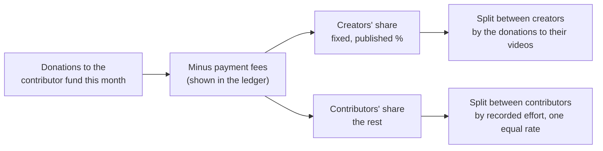

# Supporting the team

*Last updated: 30 Sep 2026 · Not final*

Viewers who love a video should be able to see exactly who made it and thank them, including with money. None of that money goes to the studio. This doc sets out how, in two steps: recognition now, a shared contributor fund later.

## Why two steps

Paying volunteers directly per video sounds simple, but it brings real problems:

| Problem | Why it matters |
| --- | --- |
| **Payments** | Common tipping services pay out through processors that don't serve Pakistan. Collecting money for others also makes the studio a money handler, which needs a registered entity, identity checks and the public ledger |
| **Fairness** | Viewers tip the faces they see (the creator, the editor), not the fact-checker or reviewer. One viral video would give its team a windfall while equally hard-working teams get nothing |
| **Motivation** | Small, irregular payments can crowd out the reason people volunteer in the first place |
| **Splitting** | Any formula that weighs one person's skill against another's creates arguments. Skill-based pay already has a home in the [paid experts](09-paid-experts.md) track |

So we start with recognition, which is free and immediate, and add money only once the studio can handle it openly and fairly.

## Step 1: Meet the team (from the pilot)

### The link on every video

Every studio-supported video's description ends with:

```
Meet the team behind this video: <studio link>/v/0142
```

### The team page

| Section | Shows |
| --- | --- |
| The video | Embedded video, title, series, date |
| The team | Every contributor, their role and their profile link, generated from the task records ([15-content-workflow.md](15-content-workflow.md)) |
| Sources | Every source the video relies on |
| AI use | The AI disclosure line ([charter section 5](03-charter.md#5-ai-transparency)) |
| Corrections | Any correction or update, with a link |
| Thank the team | Viewers leave a public thank-you note, to the whole team or to one person |

### Personal support links

Contributors can add **their own** donation or tip link to their public profile if they want. Money goes directly from the viewer to that person; the studio never handles it, never takes a share, and doesn't track it. These are personal gifts to individuals: the studio never promotes them as donations to the studio, which the law allows only into the studio's own registered account.

## Step 2: The contributor fund (after registration)

**Starts only when:** the studio is registered as a legal entity, the [public ledger](08-public-ledger.md) is live, and a payout method that works for contributors in Pakistan is in place.

### How money comes in

The team page gets a **"Support the team"** button. Viewers give any amount. The money goes into one **monthly contributor fund**, not to the single video. Pooling means a viral video's team and a quiet video's team are both rewarded for their work, and payout fees are paid once a month instead of for every tip.

### How it's shared each month



| Rule | What it means |
| --- | --- |
| **Creators' share** | A fixed, published percentage (working figure: 20%), divided among creators by how much was given on their videos' team pages |
| **Contributors' share** | Everything else, divided by **recorded effort** across all studio work that month |
| **Recorded effort, not self-reported hours** | Effort comes from the task records and the effort estimates PMs already use ([18-project-management.md](18-project-management.md)) |
| **One equal rate for every role** | An hour of fact-checking counts the same as an hour of editing. No skill multipliers |
| **Paid work doesn't count** | Tasks already paid through the paid-expert track don't also earn a share |
| **Contributor's choice** | Each person chooses: receive their share, give it back to the fund, or pass it to the new-creator budget |
| **Members of the legal entity** | Can't receive a share (a Section 42 company may not pay its members); their shares go to the new-creator budget ([20-legal-and-payments.md](20-legal-and-payments.md)) |
| **Under-18s** | Their shares go to the studio's education fund, and they are thanked publicly |
| **Minimum payout** | Shares below a minimum amount roll over to the next month, so fees don't eat them |
| **Unclaimed money** | Shares unclaimed after 6 months go to the new-creator budget |

### Transparency

- The month's total, fees, the creators' share, the contributors' share and every payout appear in the public ledger.
- Each contributor sees their own effort record and how their share was calculated.
- The team page says plainly: **"Every rupee goes to the people who made this. The studio keeps nothing."**

### Rules that don't change

- The studio takes **no share and no fee** of its own.
- Money never buys influence over content, and supporters get no special access.
- Donations don't change who gets tasks: task matching stays based on skills, capacity and fairness.
- The contributor fund is separate from donations to the studio's running costs; each is its own line in the ledger.

## Rollout

| Stage | What's live |
| --- | --- |
| Pilot | "Meet the team" link on every video; team page as a simple public page; thank-you notes; personal support links on profiles |
| Small studio | Team pages generated automatically from task records |
| Open studio (after registration and ledger) | "Support the team" button; monthly contributor fund; payouts |
