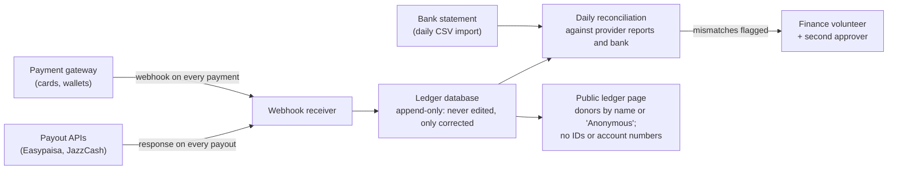

# Legal setup and payments

*Last updated: 30 Sep 2026 · Research brief, not legal advice; confirm every step with a Pakistani lawyer and tax adviser*

What it takes to become a registered non-profit in Pakistan, what the law says about raising and spending money, which payment options work, and how the public ledger can update itself. Figures are from the sources linked; where sources disagree, both are shown.

## The short version

1. **Register first, fundraise second.** In Punjab and Islamabad it is illegal to collect donations from the public (including online) before registering under the charity law. Until then, the studio takes no money at all, which matches our rule of no money before the ledger.
2. **Recommended legal form: a Section 42 company** (a non-profit company licensed by SECP). It is the most trusted by banks, donors and the tax office, and its rules on donor registers and a public website already match our transparency model. Faster and cheaper alternative: a trust.
3. **Realistic timeline:** about **2–4 months** to be registered and able to bank and fundraise in Pakistan; **12–24 months** before donors get tax credits (that needs a full audited year first).
4. **Rough cost:** one-off Rs 100–300k (fees and lawyer) plus **Rs 200k donated by each of the 3 founders** (Rs 600k total, which becomes the studio's starting funds); about Rs 100–250k a year for audit and compliance. Low-confidence estimates.
5. **PayPal and Stripe don't work in Pakistan.** Domestic donations work through local gateways, Raast and bank transfer; diaspora donors can pay by card through local gateways that accept foreign cards.
6. **Small diaspora donations are allowed** without the foreign-funding approval (under US$10,000 per donation and US$120,000 a year per person), but banks may still ask questions. Institutional foreign grants need an Economic Affairs Division approval and a year of track record.
7. **A Section 42 company can't pay its members.** People we pay (paid experts, contributor-fund payouts) must not be members of the company.
8. **The public ledger can be mostly automatic** using payment gateway webhooks; bank statements need a daily import until Pakistan's open banking goes live.

## 1. Choosing a legal form

| | Section 42 company (recommended) | Trust | Society |
| --- | --- | --- | --- |
| Law | Companies Act 2017, licensed by SECP | Punjab / ICT Trusts Act 2020 | Societies Registration Act 1860 |
| Founders needed | At least 3 promoters, all active taxpayers, 3 of them graduates | Settlor + trustee(s) | At least 7 members |
| Money from founders | Rs 200k donation + Rs 200k liability guarantee per promoter | Stamp duty + small fee | Small fee |
| Government fee | ~Rs 25,000 licence (current figure unconfirmed) | ~Rs 2,500–6,000 (low reliability) | ~Rs 2,500 (Punjab) |
| Checks | "Fit and proper" test (no tax default, fraud, AML links, overdue loans); Interior Ministry clearance only for foreign directors | Agency verification within 14 days | Unclear |
| Time | 4–8 weeks to 60–90 days | 7–12 working days (low reliability) | Unconfirmed |
| Oversight | SECP; strict, public | Registrar; lighter | Registrar; lighter |
| Trust with banks, donors, tax office | Highest | Medium | Lower |
| Paying people | Members and their close relatives can never be paid; only a non-member full-time CEO/directors | Per trust deed | Per bylaws |

**Why Section 42 fits us:** SECP already requires every donation through banking channels, a register of donors and beneficiaries, and a public website with the organisation's information. That's most of our public ledger by law. The trade-offs: a higher entry bar and strict rules on paying members.

Sources: [SECP Section 42 page](https://www.secp.gov.pk/licensing/section-42-companies/), [Companies Regulations 2024, updated 2025](https://www.secp.gov.pk/wp-content/uploads/2026/04/Companies-Regulations-2024-updated-upto-25.07.2025-Reviewed-14042026.pdf), [Punjab Trusts Act 2020](https://khalidzafar.com/wp-content/files_mf/1608551935PunjabTrustsAct2020.html), [ICLC on societies](https://iclc.com.pk/insights/society-registration-punjab), fee and timeline estimates from [Tenco](https://tencoconsulting.com/section-42-company-registration-pakistan/), [Lex-Form](https://lex-form.com/blog/secp-ngo-section-42-not-for-profit-pakistan-2026.html), [URCA](https://urcapk.com/business-setup-growth/ngo-ingo-registration-pakistan-section-42-ingo-policy-ead-rules/).

## 2. Charity registration: required before any fundraising

Registering the company or trust is not enough. Each province (and Islamabad) has a charity law that must also be followed.

| Where we're based | Law | What it means |
| --- | --- | --- |
| **Lahore / Punjab** | Punjab Charities Act 2018 | Education is a charitable purpose. **No collecting donations until registered** with the Punjab Charity Commission (a directive of 13 May 2026 repeated this and requires records kept 7 years). Fees Rs 1,000–10,000 depending on reach; register under another law first. Fines up to Rs 1m |
| **Islamabad** | ICT Charities Act 2021 | **No raising donations through mass media, including social and digital media, until registered.** Penalty up to Rs 1m and/or 6 months. Section 42 companies stay regulated by SECP, but whether the fundraising ban still applies to them is unclear: get a lawyer's opinion |
| Sindh, KP, Balochistan | Charity laws of 2019 | Matter if we operate or fundraise there |

Sources: [Punjab Charities Act 2018](https://khalidzafar.com/wp-content/files_mf/1640615629PunjabCharitiesAct2018.pdf), [Punjab Charity Commission FAQ](https://charitycommission.punjab.gov.pk/faqs-english), [ProPakistani, May 2026](https://propakistani.pk/2026/05/13/punjab-makes-registration-mandatory-for-collection-of-donation/), [ICT Charities Act 2021](https://pakistancode.gov.pk/pdffiles/administrator9ee1fef7eea67cd85a1c1f97fb16125f.pdf), [ICNL Pakistan monitor](https://www.icnl.org/resources/civic-freedom-monitor/pakistan).

**Donation crowdfunding** falls under these charity laws. SECP's crowdfunding rules are about investment crowdfunding, not donations.

## 3. Tax status

| Step | What it gives | Key conditions |
| --- | --- | --- |
| **PCP certification** (Pakistan Centre for Philanthropy) | Needed for FBR approval | Assesses governance and a completed year's performance; fee and timeline not published |
| **FBR approval under section 2(36)** | Non-profit status; valid 3 years | Constitution caps surplus at 25% of income; assets pass to another non-profit on closure; **salaries under 50% of receipts**. FBR must decide within 2 months |
| **Section 100C tax credit** | Studio's income effectively tax-free | Admin costs ≤ 15% of receipts (not in the first 3 years or under Rs 100m receipts); unspent surplus above 25% of receipts taxed at 10%; file a statement of donations |
| **Donor tax credit (section 61)** | Donors get a tax credit | Only for 2(36)-approved organisations; limits commonly cited as 30% of taxable income (individuals), 20% (companies), unconfirmed |

Finance Act 2026 lets approved non-profits get a withholding-exemption certificate for the whole tax year.

Sources: [PCP certification](https://pcp.org.pk/npo-certification-2/), [Karachi Tax Bar presentation on NPO rules](https://karachitaxbar.com/wp-content/uploads/articles/2023/Final_PRESENTATION_OPEN_DISCUSSION_NPO_UNDER_IT.pdf), [KPMG brief, Finance Act 2025](https://assets.kpmg.com/content/dam/kpmgsites/pk/pdf/2025/07/A-Brief-on-Finance-Act-2025.pdf.coredownload.inline.pdf), [KPMG brief, Finance Act 2026](https://assets.kpmg.com/content/dam/kpmgsites/pk/pdf/2026/07/A%20Brief%20of%20Finance%20Act%202026.pdf.coredownload.inline.pdf).

## 4. Money from abroad

| Source of money | Rule |
| --- | --- |
| **Individual Pakistani diaspora donors** | Excluded from the foreign-funding policy up to **US$10,000 per donation and US$120,000 a year**. But since 2020 banks have reportedly held foreign-currency transfers to non-profit accounts without an EAD approval, so **check with our bank before advertising this** |
| **Foreign institutions, grants, foundations** | Need an **MoU with the Economic Affairs Division**: at least 1 year of relevant work, active-taxpayer status, a donor commitment letter, an annual work plan, designated bank accounts; apply 60+ days before the project; first MoU is 6 months, then up to 3 years. (The policy was struck down in 2024 and restored by the Lahore High Court in April 2026) |
| **Section 42 companies** | Can't seek or accept foreign donations without prior approval from the relevant authorities |

Sources: [EAD Policy 2022 (via ICNL)](https://www.icnl.org/wp-content/uploads/NGOPOLICY2022.pdf), [Dawn, Apr 2026](https://www.dawn.com/news/1991477/federal-authority-over-ngos-foreign-funding-policy-upheld), [HBL inward remittance guidelines](https://www.hbl.com/assets/downloads/Guidelines_Inward_Remittances.pdf).

## 5. Bank account rules

- Banks apply **enhanced due diligence** to non-profits: every signatory and board member is screened; senior bank approval is needed.
- The account must be in the organisation's exact registered name.
- **Personal accounts can't be used to collect donations**, ever. (A contributor's personal tip link on their own profile, as in [19-supporting-the-team.md](19-supporting-the-team.md), is a gift to that person, not a donation to the studio; the studio must never solicit through it.)
- A Section 42 company must receive every donation through banking channels; cash only up to Rs 20,000, banked within 3 working days.

Source: [SBP AML/CFT Regulations, Regulation 6](http://www.sbp.org.pk/assets/documents/laws_regulations/CL33-Annex-B.pdf).

## 6. Paying people

| Rule | Effect on our plans |
| --- | --- |
| **Section 42: members and their close relatives can never be paid** (and not for a year after leaving) | Keep company membership small (the founders and board). **Paid experts and contributor-fund recipients must not be members** ([09-paid-experts.md](09-paid-experts.md), [19-supporting-the-team.md](19-supporting-the-team.md)) |
| Salaries ≥ 50% of receipts can block tax-exempt status | Paid work stays a minority of spending |
| Withholding tax on payments to individuals for services | Deduct and file; rates for 2026-27 conflict between sources: confirm with a tax adviser |
| Child labour laws (Punjab: no employment under 15) | **No payments to under-15s**; guardian consent for under-18s (already our policy) |

## 7. Payment options

| Option | What it's for | Fees (where published) | Automatic data (API / webhooks) | Foreign cards | Notes |
| --- | --- | --- | --- | --- | --- |
| **Safepay** | Cards, wallets, Raast | Cards 2.9% + Rs 30; wallets and Raast 1.5%; foreign cards +0.35% (its help page says 3.2%); no setup or monthly fee | Yes, webhooks | **Yes** | Clearest published pricing; confirm non-profit onboarding |
| **Raast QR** on our bank account (e.g. Bank Alfalah) | Instant bank and wallet payments by QR | 0% at Bank Alfalah; up to 0.25% allowed; government subsidy to June 2026 | No direct API (through the bank) | No | NGOs onboard with assistance at Alfalah |
| **1LINK 1BILL** | Pay from any bank app as a "bill" | Not published | Through an aggregator | No | 83 charities already listed (e.g. Edhi, Al-Khidmat) |
| **JazzCash** gateway | Wallet, cards, vouchers, Raast QR | Not published | Yes, status callback | Unconfirmed | Also has bulk disbursement products |
| **Easypaisa** | Wallet payments; disbursement and IBFT APIs | Not published directly | Yes, developer portal | Unconfirmed | Most volunteers already have a wallet |
| **HBLPay**, **PayPro**, **PayFast**, **XPay** | Card and account gateways | Quoted per merchant | Varies | PayPro says yes | Get quotes |
| **Payoneer** company account | Receiving from abroad into our bank | Not confirmed | Not confirmed | Via payment requests | Open to SECP-registered non-profits; unclear whether it allows small donations |
| **Stripe, PayPal** | – | – | – | – | **Not available in Pakistan** |
| **Wise** | Paying individual volunteers from abroad | – | – | – | Can't send to business accounts in Pakistan |

Sources: [Safepay pricing](https://getsafepay.pk/pricing), [Bank Alfalah Raast P2M](https://www.bankalfalah.com/business-banking/retail-payment-solution/raast-p2m-qr/), [Raast subsidy](https://www.app.com.pk/business/fis-to-receive-subsidy-on-raast-p2m-qrc-transactions-rs-3-5-billion-allocated-sbp/), [1LINK biller list](https://1link.net.pk/assets/documents/Biller_List_Aug_2025.pdf), [JazzCash gateway](https://www.jazzcash.com.pk/business/accept-payments/payment-gateway), [JazzCash disbursements](https://www.jazzcash.com.pk/corporate/corporate-disbursement-solutions/), [Easypaisa developer portal (news)](https://propakistani.pk/2021/05/24/easypaisa-introduces-api-developer-portal-for-seamless-third-party-integration/), [HBLPay](https://www.hbl.com/internetpaymentgateway), [PayPro](https://paypro.com.pk/gateway/), [Payoneer in Pakistan](https://www.payoneer.com/resources/country-guides/payoneer-company-account-in-pakistan/), [Stripe availability](https://stripe.com/global), [Wise PKR transfers](https://www.wise.com/help/articles/2932334/pkr-transfers).

### Recommended setup

| Money flow | Use |
| --- | --- |
| Donations from Pakistan | One gateway for cards and wallets (Safepay, with quotes from PayPro and PayFast) + a Raast QR on the bank account + later a 1BILL listing |
| Donations from the diaspora | Foreign cards through the same gateway, within the diaspora limits; bank wires once the bank confirms it will credit them |
| Institutional grants | Only after the EAD MoU (Year 2 at the earliest) |
| Payouts to people | Easypaisa / JazzCash bulk disbursement for wallets; Raast or bank transfer for bank accounts; ID details collected privately before paying |

## 8. The automatic public ledger

- **Every payment** arrives by webhook and is written once, with the provider's transaction ID (so it can't be counted twice), the amount, the fee and the time.
- **Every payout** is recorded from the payout API's response.
- **Bank transactions** (transfers, Raast) come from a daily statement import, because Pakistan's open banking is still in a regulatory sandbox (three firms selected in January 2026) ([Open Banking Expo](https://www.openbankingexpo.com/news/state-bank-of-pakistan-unveils-first-cohort-of-regulatory-sandbox-applicants/)).
- **A daily reconciliation** matches the ledger against provider settlement reports and the bank; any mismatch goes to a person.
- **The public page** shows everything required by [08-public-ledger.md](08-public-ledger.md), and doubles as the donor register and website information SECP requires.
- **Open Collective**, the best-known transparent-ledger platform, depends on Stripe and PayPal and has no Pakistan host, so we build our own ledger, a strong candidate for the first open-source code in this repo.

## 9. Step-by-step setup (Lahore, Section 42 route)

| # | Step | Time | Cost (PKR, estimates) |
| --- | --- | --- | --- |
| 1 | Choose 3+ promoters: active taxpayers, 3 graduates, clean credit reports; appoint a lawyer | 1–2 weeks | Lawyer Rs 50–150k (for the whole process) |
| 2 | Name reservation and SECP licence application | 4–8 weeks (up to 90 days) | ~25,000 licence fee (unconfirmed) |
| 3 | Incorporate within 90 days of the licence | 1–2 weeks | ~25,000 (unconfirmed) |
| 4 | Company tax number (NTN), then bank account | 2–6 weeks | Minimal |
| 5 | **Punjab Charity Commission registration; no fundraising before this** | Unconfirmed | 1,000–10,000 |
| 6 | Payment gateway, Raast QR, ledger live; start fundraising | 2–4 weeks | Per-transaction fees only |
| 7 | First full financial year (to 30 June); donor registers; public ledger | Up to 12 months | Founders' donations Rs 200k each |
| 8 | Statutory audit | 1–3 months after year-end | 50–150k a year |
| 9 | PCP certification | Unconfirmed | Unconfirmed |
| 10 | FBR 2(36) approval (donors get tax credits) | Up to 2 months | – |
| 11 | EAD MoU, only for institutional foreign grants | 60 days + 6-month first MoU | Fee to be notified |

## 10. What the studio does in the meantime

Until step 5 is done, the studio **accepts no money**: no donations, no "support the team" button, no fundraising posts. Everything else (creators, volunteers, credits, tools, the Meet the team pages and thank-you notes) runs as planned, because none of it involves money.

Points still to be confirmed with a lawyer or tax adviser are tracked in [open-questions.md](open-questions.md).
