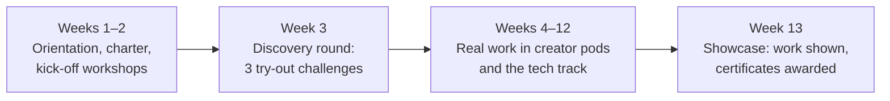

# University partnerships

*Last updated: 30 Sep 2026 · Not final*

Universities have what the studio needs most: motivated students with time and skills, faculty experts, spaces, and a reason to give students real-world experience. The studio has what universities want: real projects, industry workshops, visible credit for students, and education creators who draw an audience. This doc is the model for every university partnership; each university then gets its own proposal under [partners/](partners/).

## The exchange

No money moves in either direction. Each side gives what it has.

| The university provides | The studio provides |
| --- | --- |
| A **student cohort** that volunteers each semester, through a society or club | **Workshops** each semester: technical (software, AI tools, open source), creative (video, design, science communication), and careers |
| A **faculty coordinator** who is the studio's contact | **Seminars with education creators** on campus |
| **Rooms and equipment** for workshops and events; spaces for creator shoots | **Creator shoots on campus** featuring students (with consent) and crediting the university |
| **Faculty subject experts** for the fact-check panel, where willing | **Real work with real credit**: students' names on published videos, public contributor profiles, certificates and reference letters based on delivered work |
| **Recognition** for students, e.g. co-curricular credit or a certificate on their transcript, where the university's rules allow | **Final-year project ideas and mentoring** from the studio's open-source platform |
| A **showcase event** at the end of each semester | A **public semester report**: students involved, work delivered, videos credited |

## How it fits the charter

| Charter rule | In a university partnership |
| --- | --- |
| Free forever | No fees either way. Everything made stays free and openly licensed |
| No binding | A non-binding memorandum of understanding (MoU), renewed each semester or year; either side can end it with notice |
| Credit everyone | Every student is credited by name and role; the university is credited as a partner on work made with its students or on its campus |
| Teach, don't sell | The university gets credit, not advertising: no promotional content for the university inside education videos |
| No editorial control for partners | The university has no say over the content creators make; faculty can only review for accuracy through the fact-check panel |
| Free to leave | Students volunteer; the university may encourage but never require participation. Any student can pause or leave |
| Open by default | No exclusivity: other universities are welcome as partners |
| Urdu first, AI transparency, corrections, safeguarding | Apply to everything made through the partnership |

## The student programme: Studio Fellows

Each semester a university's cohort goes through one programme.

**Tracks** (students join one, based on the discovery round; see [17-contributors-and-teams.md](17-contributors-and-teams.md)):

| Track | Students do | Good for |
| --- | --- | --- |
| **Content** | Approach research, fact-checking, script review, idea pitching | Science, education, media, languages students |
| **Production** | Editing, design, covers, animation, subtitles | Media, design, fine arts students |
| **Technology** | Build the studio's open-source platform and AI tools (the ledger, control panel, teacher tools) | Computer science and software engineering students |
| **Operations** | Assistant project management, community, analytics | Business and management students |

**Recognition:** certificates are based on work delivered (tasks approved, credited videos), not attendance. Students who deliver consistently get a reference letter and a public profile they can show employers.

## Workshop catalogue

| Area | Workshop |
| --- | --- |
| **Technology** (led by the founder, a software engineer) | Git and GitHub for teams · Contributing to open source · Building web apps · Building with AI APIs responsibly · Automating workflows · Data, dashboards and the public ledger |
| **Creative** | Short-form storytelling and hooks · Editing on a phone · Design basics and series identity · Animation for explainers |
| **Knowledge** | Science communication · Fact-checking and sources · Media, misinformation and AI literacy · AI disclosure and ethics |
| **Careers** | Building a portfolio from real work · Freelancing and remote work basics |

## Events on campus

- **Creator seminar:** an education creator talks about teaching 50,000+ people online, with a live Q&A.
- **Creator shoot day:** a creator films on campus, e.g. "Street Questions" with students or a lab experiment. Students on camera give written consent.
- **Hook challenge:** students compete to write the best opening for a science topic; winners' hooks are used and credited.
- **EdTech build weekend:** CS students build small tools for teachers from the [technology idea bank](06-technology.md).
- **Semester showcase:** the cohort presents its work to faculty and creators.

## Final-year projects

The studio's platform is open source and needs real software built, so it can offer supervised final-year project topics, co-mentored by the founder and a faculty supervisor. Examples: the automatic public ledger ([20-legal-and-payments.md](20-legal-and-payments.md)), the pledge and task-matching system, the capacity board, the asset library website, an Urdu scientific glossary with pronunciation, a teacher quiz builder.

## How a partnership runs

| Step | What happens |
| --- | --- |
| 1. Introduction | A faculty contact introduces the studio; a short meeting with the relevant department or student affairs office |
| 2. Proposal | The university-specific proposal is shared (template: [partners/](partners/)) |
| 3. Pilot semester | Starts with a simple letter of intent; one cohort, a few workshops, one creator event |
| 4. Review | Both sides review the pilot using the semester report |
| 5. MoU | A formal, non-binding MoU for a year, signed once the studio is a registered entity ([20-legal-and-payments.md](20-legal-and-payments.md)) |
| 6. Every semester | New cohort, workshop plan, events, report |

## Measures

| Measure | Why |
| --- | --- |
| Students onboarded and active at semester end | Is the programme keeping people? |
| Pledged vs delivered hours | Is the cohort reliable? |
| Tasks approved; videos credited | Real output |
| Workshops delivered; attendance; feedback | Is the studio keeping its side? |
| Students continuing after the semester | Is it building long-term contributors? |
